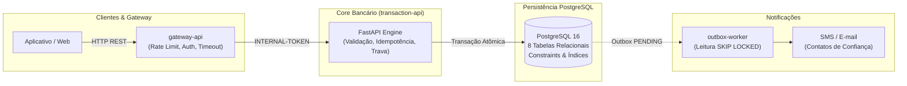
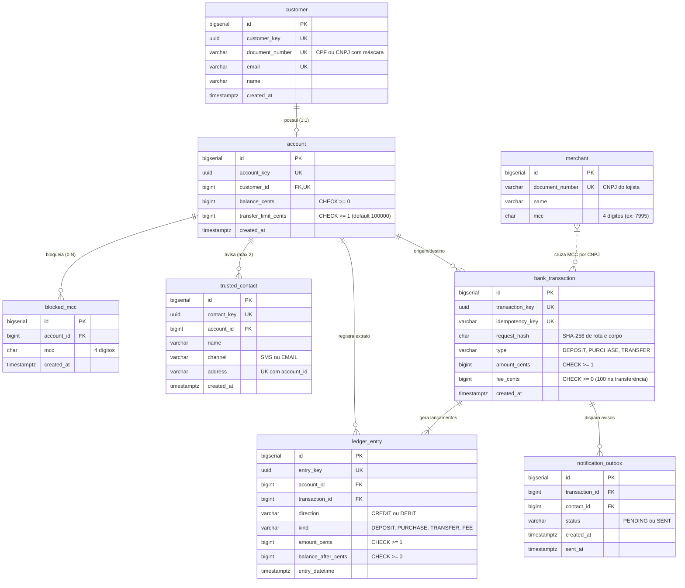

# BANCO 60+ | API de Transações Bancárias com Proteção Antivícios


[](https://www.python.org/)
[](https://fastapi.tiangolo.com/)
[](https://www.postgresql.org/)
[](https://www.docker.com/)
[-success.svg?logo=pytest&logoColor=white)](https://docs.pytest.org/)
[](./LICENSE)

> **Documento Base:** RFC: BANCO 60+, com saldo protegido, Cofre Antivícios e Contato de Confiança  
> **Autores da RFC:** Isadora de Francisco, Henrique Manco e Viitor Robusti  

---

## Sumário
1. [Contextualização e Proposta do Projeto](#1-contextualização-e-proposta-do-projeto)
2. [As Seis Garantias Fundamentais](#2-as-seis-garantias-fundamentais)
3. [Arquitetura da Solução e Decisões Técnicas](#3-arquitetura-da-solução-e-decisões-técnicas)
4. [Modelo de Dados (PostgreSQL)](#4-modelo-de-dados-postgresql)
5. [Passo a Passo de Instalação e Execução](#5-passo-a-passo-de-instalação-e-execução)
6. [Execução dos Testes Automatizados](#6-execução-dos-testes-automatizados)
7. [Catálogo de Endpoints da API](#7-catálogo-de-endpoints-da-api)
8. [Exemplos Práticos de Uso](#8-exemplos-práticos-de-uso)
9. [Matriz de Códigos de Erro (BNK)](#9-matriz-de-códigos-de-erro-bnk)
10. [Estrutura do Projeto](#10-estrutura-do-projeto)

---

## 1. Contextualização e Proposta do Projeto

O **BANCO 60+** é uma solução bancária concebida sob medida para aposentados e pensionistas com mais de 60 anos. Esse público reúne características financeiras muito específicas: possuem **renda estável e previsível**, porém enfrentam **baixa fluência digital**, tornando-se os alvos preferenciais de golpes de engenharia social, fraudes com cartões e compulsão por plataformas de apostas online (*bets*).

Para proteger o patrimônio desse público sem gerar atritos desnecessários, a plataforma foi estruturada em torno de três pilares de proteção:
1. **Saldo Rigorosamente Protegido:** Dinheiro mantido estritamente em números inteiros (centavos) com transações atômicas e serialização contra concorrência agressiva.
2. **Cofre Antivícios Integrado:** Bloqueio preventivo de categorias de risco (MCC `7995` - jogos de azar, apostas e loterias), validando tanto o código informado na compra quanto o cadastro oficial do lojista (CNPJ).
3. **Rede de Apoio Familiar (Contatos de Confiança):** Notificação em tempo real de até dois familiares por meio de eventos assíncronos (*Transactional Outbox Pattern*).

---

## 2. As Seis Garantias Fundamentais

A plataforma sustenta seis garantias inegociáveis formalizadas na RFC:

* 🛡️ **Saldo nunca negativo e igual ao extrato:** Mesmo sob corrida de requisições simultâneas. Se duas transferências de R$ 80,00 disputarem uma conta com saldo de R$ 100,00, a primeira é aprovada e a segunda é rejeitada com clareza.
* 🔁 **Nada em dobro (Idempotência Estrita):** Repetições de requisições causadas por oscilações de conectividade não debitam duas vezes. A idempotência é controlada por hash criptográfico canônico cobrindo rota, conta e corpo.
* 📜 **Extrato reconstrói o saldo:** Lançamento a lançamento em um *Ledger* contábil imutável (*append-only*).
* 🏷️ **Tarifa visível:** Toda transferência debita uma tarifa fixa de R$ 1,00 (`FEE`) como linha própria no extrato, nunca embutida silenciosamente no valor transferido.
* 🔒 **Cofre antes do dinheiro:** Operações com estabelecimentos bloqueados são interceptadas e recusadas antes de qualquer bloqueio de saldo ou movimento financeiro.
* 💬 **Motivo claro e seguro:** Todos os retornos de erro informam código de domínio (`BNK`), título, descrição em português e campo afetado, sem jamais expor *stack traces*, CPFs ou e-mails completos.

---

## 3. Arquitetura da Solução e Decisões Técnicas



### O Funil de 7 Passos das Operações Financeiras

Todo movimento de dinheiro atravessa um funil rigoroso em 7 etapas que filtra requisições inválidas antes de concorrer por travas de banco:

```mermaid
flowchart TD
    A["1. Validação Rápida<br/>(Cabeçalhos, JSON Schema e Tipos)"] -->|Inválido: 400| E1[BNK000001]
    A --> B["2. Busca de Contas sem Trava<br/>(Existência e limite por transferência)"]
    B -->|Inexistente: 404 / Limite: 422| E2[BNK002001 / BNK004003]
    B --> C["3. Reserva de Idempotência<br/>(INSERT ... ON CONFLICT DO NOTHING)"]
    C -->|Replay com mesmo hash: 200| OK1[Retorna saldo original]
    C -->|Mesma chave, outro corpo: 409| E3[BNK000012]
    C --> D["4. Cofre Antivícios<br/>(Verifica MCC do pedido e CNPJ do lojista)"]
    D -->|Bloqueado: 422 (Rollback libera chave)| E4[BNK004004]
    D --> E["5. Trava Ordenada de Linhas<br/>(SELECT ... ORDER BY id FOR UPDATE)"]
    E --> F["6. Conferência Atômica de Saldo<br/>(Saldo >= Valor + Tarifa)"]
    F -->|Insuficiente: 409| E5[BNK004001]
    F --> G["7. Gravação de Lançamentos e Outbox<br/>(Ledger imutável, saldo e evento PENDING)"]
    G --> H["COMMIT e Resposta 201 Created"]
```

### Por que estas decisões foram tomadas:
* **Centavos inteiros (`BIGINT`) em vez de `FLOAT` ou `NUMERIC`:** Elimina erros de arredondamento inerentes a ponto flutuante ($0.1 + 0.2 \neq 0.3$) e evita overhead de conversão decimal sem perda de precisão contábil.
* **Trava ordenada (`ORDER BY id FOR UPDATE`):** Evita *deadlocks* em transferências simultâneas cruzadas entre contas ($A \to B$ e $B \to A$).
* **Outbox Pattern:** Desacopla a entrega de notificações (SMS/e-mail) da transação bancária, impedindo que falhas de rede em serviços externos travem o banco de dados.

---

## 4. Modelo de Dados (PostgreSQL)

O banco de dados é composto por **8 tabelas relacionais**, normalizadas e protegidas por restrições de integridade no próprio PostgreSQL:



---

## 5. Passo a Passo de Instalação e Execução

### Pré-requisitos
* [Docker Desktop](https://www.docker.com/products/docker-desktop/) instalado e em execução (com Docker Compose v2).
* Git instalado.

### 1. Clonar o repositório e entrar na pasta do projeto
```bash
git clone https://github.com/HenriqueJCManco/BootcampQITech.git
cd BootcampQITech/bootcamp-base-api
```

### 2. Subir os containers (API + PostgreSQL)
Com apenas um comando, o Docker Compose inicializa o banco de dados com todas as tabelas e sobe a aplicação FastAPI com recarregamento automático:

```bash
docker compose up --build -d
```

### 3. Verificar se o serviço está ativo
```bash
# Rota pública de identificação
curl -s http://localhost:3000/

# Rota pública de health check (deve retornar 204 No Content)
curl -s -i http://localhost:3000/health_check
```

---

## 6. Execução dos Testes Automatizados

A suíte de testes cobre integralmente os fluxos unitários, regras de validação e **cenários de concorrência massiva multi-thread** (disputa de saldo, bloqueio de contatos e replays simultâneos).

### Executar a suíte de testes via Docker (Recomendado):
Não é necessário instalar Python na máquina hospedeira:

```bash
docker compose --profile test run --rm test
```

> **Resultado esperado:** `14 passed in 2.4s` (100% de sucesso).

### Executar localmente com Python 3.11 (Opcional):
```powershell
# Criação e ativação do ambiente virtual
python -m venv .venv
.\.venv\Scripts\Activate.ps1

# Instalação das dependências de teste
pip install -r requirements-dev.txt

# Execução dos testes
pytest
```

---

## 7. Catálogo de Endpoints da API

Todas as rotas (exceto `/` e `/health_check`) exigem o cabeçalho de autenticação interna:
```http
INTERNAL-TOKEN: default_token
```

| Método | Rota | Cabeçalhos Obrigatórios | Descrição | Status Sucesso |
| :--- | :--- | :--- | :--- | :---: |
| `GET` | `/` | — | Identificação da API | `200` |
| `GET` | `/health_check` | — | Checagem de saúde da aplicação | `204` |
| `POST` | `/customer` | `INTERNAL-TOKEN` | Cadastra cliente PF ou PJ | `201` |
| `GET` | `/customer/{customer_key}` | `INTERNAL-TOKEN` | Consulta cliente por chave UUID | `200` |
| `POST` | `/account` | `INTERNAL-TOKEN` | Cria conta (saldo 0 e MCC 7995 bloqueado) | `201` |
| `GET` | `/account/{account_key}` | `INTERNAL-TOKEN` | Consulta saldo, limites e MCCs bloqueados | `200` |
| `PUT` | `/account/{account_key}/blocked_mcc` | `INTERNAL-TOKEN` | Atualiza lista de MCCs bloqueados do Cofre | `200` |
| `POST` | `/account/{account_key}/trusted_contact` | `INTERNAL-TOKEN` | Cadastra contato de confiança (máx. 2) | `201` |
| `POST` | `/account/{account_key}/deposit` | `INTERNAL-TOKEN`, `Idempotency-Key` | Realiza depósito (em centavos) | `201` / `200` |
| `POST` | `/account/{account_key}/purchase` | `INTERNAL-TOKEN`, `Idempotency-Key` | Realiza compra com cartão (valida Cofre) | `201` / `200` |
| `POST` | `/transfer` | `INTERNAL-TOKEN`, `Idempotency-Key` | Transfere valores com tarifa de R$ 1,00 | `201` / `200` |
| `GET` | `/account/{account_key}/statement` | `INTERNAL-TOKEN` | Extrato paginado (`limit`, `page`) | `200` |

---

## 8. Exemplos Práticos de Uso

### 1. Cadastrar um Cliente (com CPF ou CNPJ formatado)
```bash
curl -X POST http://localhost:3000/customer \
  -H "INTERNAL-TOKEN: default_token" \
  -H "Content-Type: application/json" \
  -d '{
    "name": "Sebastião da Silva",
    "email": "sebastiao@exemplo.com",
    "document_number": "529.982.247-25"
  }'
```

### 2. Abrir uma Conta
```bash
curl -X POST http://localhost:3000/account \
  -H "INTERNAL-TOKEN: default_token" \
  -H "Content-Type: application/json" \
  -d '{
    "customer_key": "<UUID_DO_CLIENTE>",
    "transfer_limit_cents": 100000
  }'
```

### 3. Cadastrar Contato de Confiança (Máximo 2)
```bash
curl -X POST http://localhost:3000/account/<UUID_DA_CONTA>/trusted_contact \
  -H "INTERNAL-TOKEN: default_token" \
  -H "Content-Type: application/json" \
  -d '{
    "name": "Mariana da Silva (Filha)",
    "channel": "EMAIL",
    "address": "mariana.filha@exemplo.com"
  }'
```

### 4. Realizar Depósito Idempotente (R$ 500,00)
```bash
curl -X POST http://localhost:3000/account/<UUID_DA_CONTA>/deposit \
  -H "INTERNAL-TOKEN: default_token" \
  -H "Idempotency-Key: dep-001-abc" \
  -H "Content-Type: application/json" \
  -d '{
    "amount_cents": 50000
  }'
```

### 5. Realizar Transferência com Tarifa (R$ 100,00 + R$ 1,00 de tarifa)
```bash
curl -X POST http://localhost:3000/transfer \
  -H "INTERNAL-TOKEN: default_token" \
  -H "Idempotency-Key: trf-001-xyz" \
  -H "Content-Type: application/json" \
  -d '{
    "from_account_key": "<UUID_CONTA_ORIGEM>",
    "to_account_key": "<UUID_CONTA_DESTINO>",
    "amount_cents": 10000
  }'
```

### 6. Consultar Extrato Paginado
```bash
curl -X GET "http://localhost:3000/account/<UUID_DA_CONTA>/statement?limit=10&page=0" \
  -H "INTERNAL-TOKEN: default_token"
```

---

## 9. Matriz de Códigos de Erro (BNK)

Todas as respostas de erro retornam um envelope padronizado contendo `title`, `description`, `translation` (em português), `code`, `request_id` e lista de `errors`:

```json
{
  "title": "Operation blocked by MCC protection",
  "description": "The operation matches an MCC blocked for this account.",
  "translation": "A operação corresponde a um MCC bloqueado para esta conta.",
  "code": "BNK004004",
  "request_id": "c1f7a0b5-4b12-4f6c-8e43-982e5b7190c1",
  "errors": []
}
```

| HTTP Status | Código BNK | Cenário de Ocorrência |
| :---: | :---: | :--- |
| `400` | `BNK000001` | Corpo, cabeçalho ou parâmetro de consulta fora do formato esperado |
| `403` | `BNK000002` | `INTERNAL-TOKEN` ausente ou incorreto |
| `400` | `BNK000011` | Cabeçalho `Idempotency-Key` ausente em operação de dinheiro |
| `409` | `BNK000012` | Mesma chave de idempotência reenviada com corpo diferente |
| `404` | `BNK000404` | Rota ou recurso HTTP inexistente |
| `409` | `BNK001001` | Documento (CPF/CNPJ) ou e-mail já cadastrado |
| `422` | `BNK001002` | CPF ou CNPJ com dígitos verificadores inválidos |
| `404` | `BNK001003` | Cliente não encontrado |
| `404` | `BNK002001` | Conta não encontrada |
| `409` | `BNK002002` | Cliente já possui conta cadastrada |
| `400` | `BNK002003` | Limite por transferência menor que 1 centavo |
| `400` | `BNK002004` | Lista de MCCs fora do formato (deve conter 4 dígitos por MCC) |
| `409` | `BNK003001` | Limite de contatos de confiança atingido (máximo de 2 por conta) |
| `409` | `BNK003002` | Contato de confiança com mesmo endereço já cadastrado na conta |
| `409` | `BNK004001` | Saldo insuficiente (considera valor + tarifa na transferência) |
| `422` | `BNK004002` | Transferência para a mesma conta (origem igual ao destino) |
| `422` | `BNK004003` | Valor da transferência excede o limite configurado na conta |
| `422` | `BNK004004` | Operação bloqueada pelo Cofre Antivícios (MCC 7995 / apostas) |
| `422` | `BNK004005` | CNPJ do lojista com dígitos verificadores inválidos |
| `400` | `BNK004006` | Valor monetário menor que 1 centavo |
| `503` | `BNK004007` | Timeout ao aguardar trava de linha no banco de dados |

---

## 10. Estrutura do Projeto

A arquitetura adota separação estrita de responsabilidades:

```text
bootcamp-base-api/
├── database/
│   └── database.sql               # Esquema relacional DDL (8 tabelas, constraints e índices)
├── docs/
│   ├── banco60_banner.jpg         # Identidade visual da arquitetura
│   └── como-o-projeto-e-organizado.md
├── src/
│   ├── app.py                     # Entrypoint FastAPI e registro de rotas/middlewares
│   ├── constants.py               # Variáveis de ambiente e configuração
│   ├── controllers/               # Regras de negócio, funil de 7 passos e transações
│   ├── dtos/                      # Objetos de transferência de dados e envelopes HTTP
│   ├── errors/                    # Hierarquia de exceções QI e códigos BNK
│   ├── middlewares/               # Token interno, log seguro, request_id e contexto DB
│   ├── models/                    # Mapeamento objeto-relacional (SQLAlchemy)
│   ├── repositories/              # Consultas SQL, travas FOR UPDATE e queries atômicas
│   ├── resources/                 # Controladores de rotas HTTP e validação JSON Schema
│   ├── schemas/                   # Esquemas JSON para validação estrita de payload
│   └── utils/                     # Algoritmos de CPF/CNPJ, UUID e formatação de log
├── tests/
│   └── integration/banking/       # Testes de integração e concorrência massiva
├── docker-compose.yml             # Orquestração da API, PostgreSQL e suite de testes
├── Dockerfile                     # Imagem Docker multi-stage otimizada
└── requirements.txt               # Dependências de produção
```
