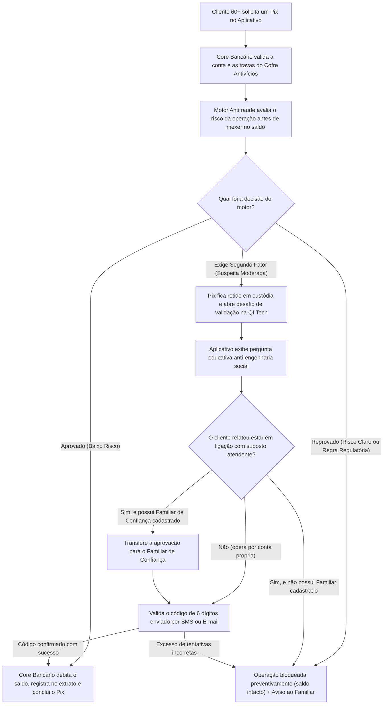
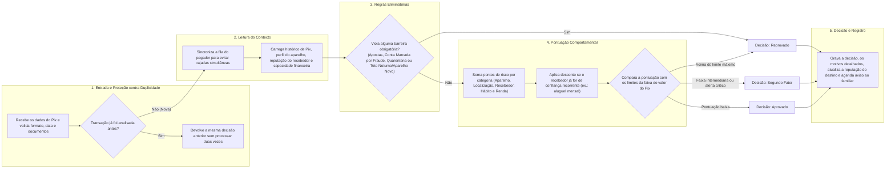
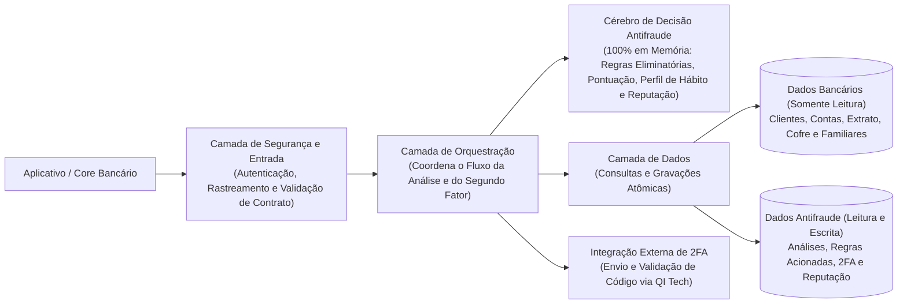
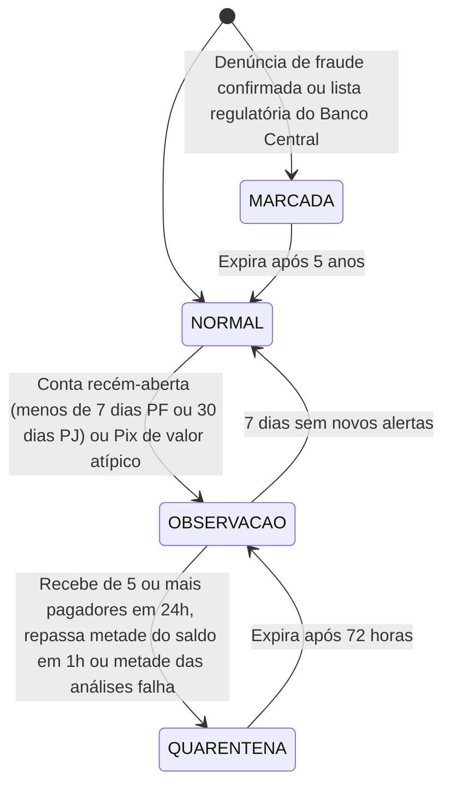
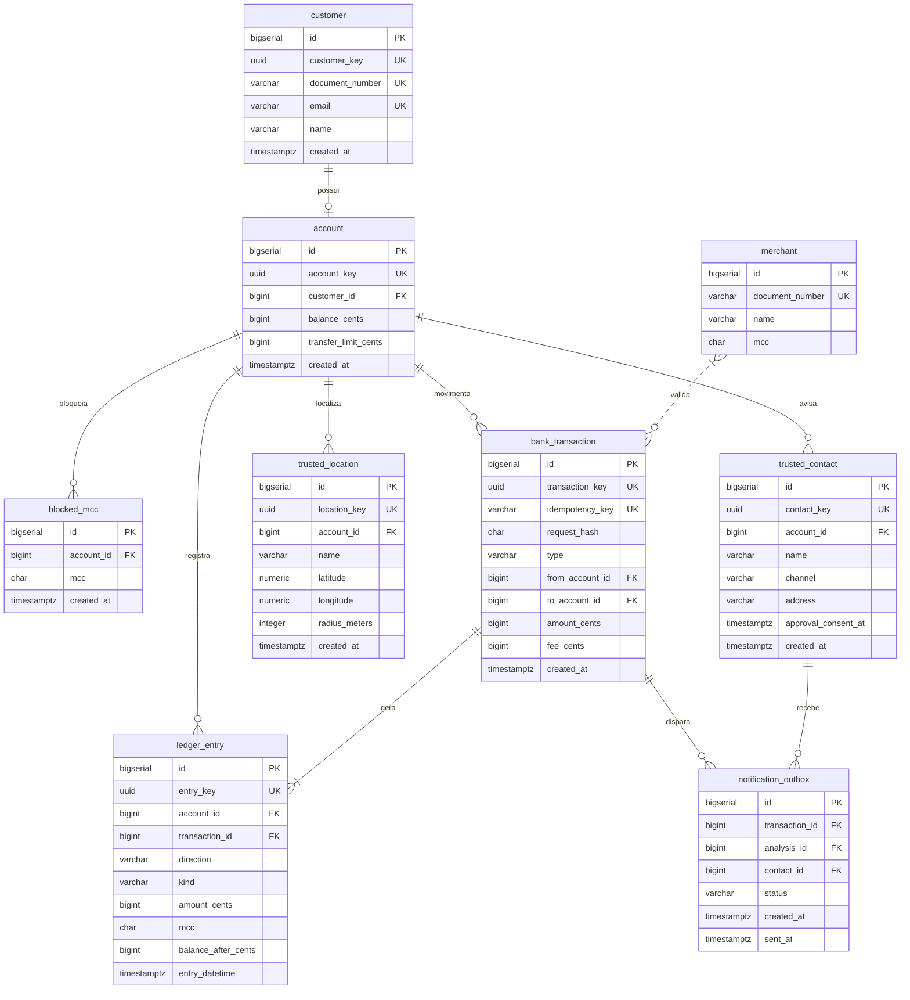
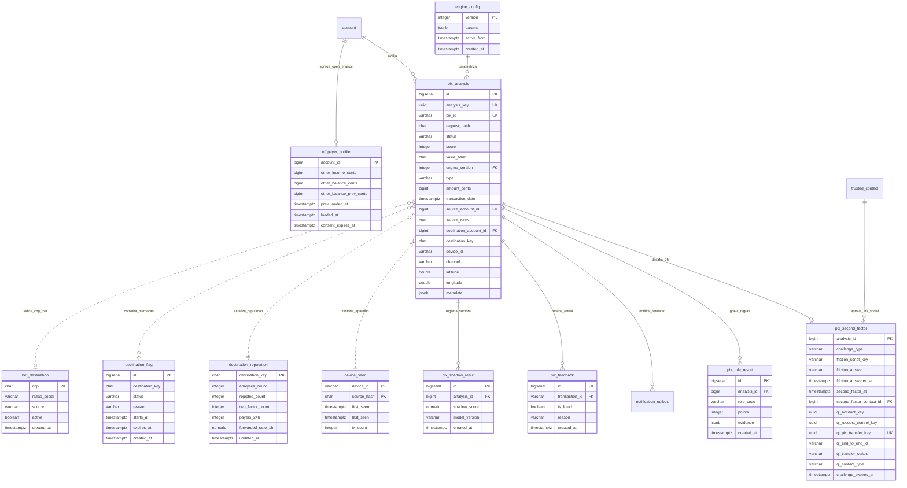

# Pix Seguro 60+ | Core Bancário & Motor Antifraude Pix (BANCO 60+)

**Integrantes:** Isadora de Francisco, Henrique Manco e Vitor Robusti — Hackathon QI Tech 2026 · motor v0.1 (`engine_config` versão 1)

[](https://www.python.org/)
[](https://fastapi.tiangolo.com/)
[](https://www.postgresql.org/)
[](https://www.docker.org/)
[-success.svg?logo=pytest&logoColor=white)](https://docs.pytest.org/)
[](./LICENSE)

Antifraude de Pix para um banco de público 60+ (aposentados e pensionistas, renda estável, pouca fluência digital). A fricção só aparece onde há dúvida: aprovar é o padrão, 2FA é o meio-termo e reprovar exige risco claro.

> Tudo que não vem da pesquisa do time está marcado como **hipótese**. Os limiares se ancoram em limites reais do Banco Central, mas precisam de calibração (ver [Resultado do backtest](#resultado-do-backtest)). A API bancária sobre a qual o motor roda está descrita em [docs/banco-60.md](docs/banco-60.md) e a apresentação executiva do produto está em [docs/apresentacao-comercial-produto.md](docs/apresentacao-comercial-produto.md).

---

## Sumário

1. [Como o motor de decisão funciona](#como-o-motor-de-decisão-funciona)
2. [Rotas e Contrato da API](#rotas-e-contrato-da-api)
3. [Regras do Motor Antifraude (24 Regras)](#regras)
4. [Como as regras viram decisão e 2FA via QI Tech](#como-as-regras-viram-decisão)
5. [Modelo de Dados e Valores Reais do Banco](#modelo-de-dados)
6. [Como rodar, testar e Mapa dos 141 Testes](#como-rodar-e-testar)
7. [Resultado do backtest](#resultado-do-backtest)
8. [Códigos de erro (`AFP` e `BNK`)](#códigos-de-erro)
9. [Premissas e fora do escopo](#premissas-e-fora-do-escopo)

---

## Como o motor de decisão funciona

O **Motor Antifraude Pix Seguro 60+** avalia cada Pix **antes de o dinheiro sair da conta** e devolve uma de três decisões:
* **Aprovado (`approved`):** a operação segue normalmente para transferência do saldo;
* **Segundo Fator Obrigatório (`two_factor_required`):** a operação fica retida aguardando confirmação por código de segurança (enviado ao próprio idoso ou ao seu Contato de Confiança familiar);
* **Reprovado (`rejected`):** a operação é bloqueada preventivamente e o saldo permanece intacto.

Toda a análise ocorre em **uma única passagem síncrona**, consultando apenas dados locais já existentes no banco, sem depender de chamadas externas lentas durante a avaliação do risco.

---

### 1. Onde o Motor Entra na Jornada do Pix (Visão de Ponta a Ponta)

No Banco 60+, o motor atua como um **portão de segurança intermediário**: ele é acionado depois que o banco confere os dados básicos da conta e do Cofre Antivícios, mas **antes** de movimentar o saldo ou registrar débitos no extrato.



* **Por que essa posição importa:** como o motor grava sua análise antes da movimentação financeira, mesmo quando um Pix é bloqueado e a transferência bancária é cancelada, o histórico completo da tentativa de golpe permanece salvo para proteger as próximas operações.

---

### 2. Fluxo de Avaliação de um Pix Dentro do Motor

Quando uma transação chega ao motor, ela passa por **5 etapas sequenciais** que separam bloqueios imediatos de comportamentos suspeitos graduais:



1. **Proteção contra duplicidade:** se o aplicativo reenviar o mesmo Pix por oscilação de internet, o motor reconhece o identificador e devolve a mesma resposta sem recalcular nem duplicar contadores.
2. **Fila por pagador:** apenas transações da **mesma pessoa** aguardam em fila para impedir que duas transferências simultâneas burlem o limite diário; clientes diferentes são atendidos em paralelo.
3. **Barreiras eliminatórias antes da pontuação:** regras regulatórias ou de proteção absoluta (como casas de apostas bloqueadas, contas denunciadas por fraude ou excesso noturno para desconhecidos) reprovam imediatamente.
4. **Pontuação proporcional ao valor:** quanto maior o valor do Pix, menor a tolerância a sinais de risco. Além disso, sinais da mesma natureza têm um limite máximo para não punir duas vezes pelo mesmo motivo.
5. **Memória contínua:** ao final de cada análise, o motor atualiza automaticamente a reputação do recebedor e o histórico do aparelho.

---

### 3. Arquitetura do Código (Divisão de Responsabilidades)

O código foi estruturado em camadas independentes para que o **Cérebro de Regras Antifraude** funcione 100% isolado de detalhes de rede ou de banco de dados:



* **Camada de Segurança e Entrada (`middlewares` + `resources`):** confere a credencial interna da requisição, valida se todos os campos enviados respeitam o formato esperado e formata a resposta final.
* **Camada de Orquestração (`controllers`):** coordena o passo a passo — pede os dados ao banco, entrega tudo pronto para o cérebro antifraude decidir, salva o resultado e, quando necessário, aciona o envio de token na QI Tech.
* **Cérebro de Decisão Antifraude (`domain`):** contém toda a inteligência das 24 regras, cálculo estatístico de hábito do idoso e classificação de risco. Não faz chamadas de rede nem consultas SQL, o que garante velocidade em milissegundos e 100% de cobertura em testes unitários.
* **Camada de Dados (`repositories` + `models`):** único ponto que conversa com o PostgreSQL. Lê os dados cadastrais e de extrato do banco (sem nunca alterar saldo) e grava todas as evidências e decisões no ambiente antifraude.

### Garantias de Produto e Engenharia

1. **Decisão rápida em uma única passagem:** nenhuma chamada externa ocorre durante o cálculo de risco; dados do Open Finance são consultados localmente e o envio de token 2FA ocorre apenas após a decisão.
2. **Fricção somente onde há dúvida:** transações habituais (como pagar o mesmo aluguel todo mês) recebem bônus de confiança e passam sem bloqueio.
3. **Explicabilidade completa sem expor a regra ao fraudador:** cada decisão salva internamente quais sinais foram acionados e seus valores exatos para auditoria, mas o aplicativo recebe apenas uma mensagem amigável orientando o cliente.

---

## Rotas e Contrato da API

### Rotas do Motor Antifraude Pix (`/pix/*`)

| Método | Caminho | O que faz |
| --- | --- | --- |
| `POST` | `/pix/transaction` | Analisa o Pix, grava e responde. `201` na primeira vez; `200` na repetição do mesmo corpo |
| `GET` | `/pix/transaction/{id}` | Devolve a análise gravada; `404` se não existe |
| `POST` | `/pix/feedback` | Grava o rótulo `{ transaction_id, is_fraud, reason }` (evolução: massa rotulada) |
| `POST` | `/pix/transaction/{id}/second_factor` | Abre o 2FA na QI Tech para um Pix em `two_factor_required`: `201` na primeira vez, `200` se o desafio já está aberto |
| `PUT` | `/pix/transaction/{id}/second_factor/token` | Confirma o token na QI Tech (com `friction_answer` opcional) |
| `PATCH` | `/pix/transaction/{id}/second_factor/token` | Pede à QI Tech um novo token (reinicia os 5 minutos) |
| `GET` | `/health_check` | Diz se está de pé (`204`) |

### Rotas do Core Bancário Banco 60+ ([docs/banco-60.md](docs/banco-60.md))

| Método | Caminho | Cabeçalhos Obrigatórios | O que faz | Status |
| --- | --- | --- | --- | :---: |
| `GET` | `/` | — | Identificação da API | `200` |
| `POST` | `/customer` | `INTERNAL-TOKEN` | Cadastra cliente PF ou PJ | `201` |
| `GET` | `/customer/{customer_key}` | `INTERNAL-TOKEN` | Consulta cliente por chave UUID | `200` |
| `POST` | `/account` | `INTERNAL-TOKEN` | Cria conta (saldo 0 e MCC `7995` bloqueado por padrão) | `201` |
| `GET` | `/account/{account_key}` | `INTERNAL-TOKEN` | Consulta saldo, limites e MCCs bloqueados | `200` |
| `PUT` | `/account/{account_key}/blocked_mcc` | `INTERNAL-TOKEN` | Atualiza lista de MCCs bloqueados do Cofre Antivícios | `200` |
| `POST` | `/account/{account_key}/trusted_contact` | `INTERNAL-TOKEN` | Cadastra Contato de Confiança (máx. 2 por conta) | `201` |
| `POST` | `/account/{account_key}/deposit` | `INTERNAL-TOKEN`, `Idempotency-Key` | Realiza depósito em centavos | `201` / `200` |
| `POST` | `/account/{account_key}/purchase` | `INTERNAL-TOKEN`, `Idempotency-Key` | Realiza compra com cartão (valida Cofre Antivícios) | `201` / `200` |
| `POST` | `/transfer` | `INTERNAL-TOKEN`, `Idempotency-Key` | Transfere valores com tarifa visível de R$ 1,00 | `201` / `200` |
| `GET` | `/account/{account_key}/statement` | `INTERNAL-TOKEN` | Extrato paginado (`limit`, `page`) | `200` |

Todas as rotas, menos `/` e `/health_check`, exigem o cabeçalho `INTERNAL-TOKEN` (`default_token` no ambiente local). Ausente ou errado nas rotas `/pix/*`, a resposta é `403 AFP000002`, e a comparação é feita em tempo constante (`hmac.compare_digest`). **Reprovar um Pix não é erro**: a resposta é `201` com `status: rejected`.

**Entrada.** Valores em centavos (inteiro ≥ 1) e `transaction_date` com fuso. Campos opcionais ausentes desligam a regra correspondente e entram em `metadata.inputs_missing`; a requisição não falha. `source.channel` aceita `internet`, `celular`, `computador` e `tablet`. O alias `app` é gravado como `celular`.

```json
{
  "id": "6f1c2b0e-0d7a-4f1e-9a51-2c1f8f0b9a10",
  "amount": 18900,
  "transaction_date": "2026-10-15T14:35:00-03:00",
  "type": "payment",
  "source_account": { "document_number": "529.982.247-25", "has_trusted_contact": true },
  "destination_account": {
    "document_number": "111.444.777-35",
    "participant": "60701190", "branch": "0001", "number": "4455667"
  },
  "source": {
    "channel": "app",
    "device_id": "cel-maria",
    "remote_access_detected": false,
    "call_in_progress": false
  }
}
```

**Saída.** Abaixo, uma resposta real do motor na massa sintética: o terceiro Pix de um fracionamento (três Pix logo abaixo de R$ 200 para destinos novos em pouco tempo). O score 80 passa o corte de 2FA da faixa A (45), mas fica abaixo do de reprovar (85).

```json
{
  "key": "75a4e5f9-d686-4a25-ba60-1955ec92a4c1",
  "status": "two_factor_required",
  "metadata": {
    "engine_version": 1,
    "score": 80,
    "value_band": "A",
    "thresholds": { "two_factor": 45, "reject": 85 },
    "rules_fired": [
      { "code": "G4", "points": 5, "evidence": { "channel": "celular", "segment": "mobile" } },
      { "code": "C1", "points": 15, "evidence": { "previous_pix_to_destination": 0 } },
      { "code": "M2", "points": 30, "evidence": { "ceiling_cents": 20000, "pix_near_ceiling": 3 } },
      { "code": "V2", "points": 30, "evidence": { "new_destinations_1h": 3 } }
    ],
    "floor_applied": [],
    "payer_class": "PF",
    "destination_status": "NORMAL",
    "destination_reputation": { "analyses_count": 0, "suspicious_ratio": 0.0 },
    "notify_trusted_contact": true,
    "customer_message_key": "CONFIRM_IDENTITY",
    "inputs_missing": ["geolocation", "destination_account.created_at"],
    "challenge_type": "CUSTOMER_TOKEN_2FA",
    "friction_script_key": "CONFIRM_IDENTITY",
    "friction_params": {}
  }
}
```

---

## Regras

**Nenhum limiar fica fixo no código.** Todos os parâmetros abaixo são lidos de `fraude.engine_config` (versionado, com `active_from`), e cada análise grava a versão usada. A equipe de dados recalibra inserindo uma versão nova, sem refatorar. Os códigos seguem a pesquisa do time (E, D, G, K, C, P, M, V, O, R, H, X), mais F para os sinais do Open Finance.

### Eliminatórias (rodam antes do score; qualquer uma reprova)

| Regra | Lógica | Parâmetros | Por quê |
| --- | --- | --- | --- |
| **E1 Cofre Antivícios** | O MCC do CNPJ de destino (tabela `merchant`) está nos `blocked_mcc` da conta | padrão `7995` (apostas/bets) | Garantia herdada do Banco 60+: o dinheiro não vai para casas de apostas ou categorias que o cliente bloqueou (exceto devoluções `refund`). Quem recebe Pix não informa MCC, então lemos o cadastro do CNPJ |
| **E2 Destino marcado** | Destino com marcação `MARCADA` ativa e `type` diferente de `refund` | validade de 5 anos; flag `ENABLE_BCB_587_RULES` | Res. BCB 587 (publicada em 18/09/2026). Adotamos antes da vigência, com data de expiração na tabela |
| **E3 Quarentena** | Destino em `QUARENTENA` e pagador sem beneficiário de confiança (H2) | até 72 h | Espelho interno do bloqueio cautelar de até 72 h do BC (hipótese: o do BC é do lado recebedor) |
| **E4 Limite noturno** | PF (11 dígitos) ou MEI, das 20h às 6h (fuso `America/Sao_Paulo`), acima do teto, para destino sem pré-cadastro | teto R$ 1.000; pré-cadastro = Pix aprovado ao mesmo destino há 24 h ou mais; PJ só com `APPLY_NIGHT_LIMIT_PJ` | Res. BCB 142/2021. Sequestro-relâmpago acontece à noite, e o 60+ raramente opera nesse horário |
| **E5 Aparelho não conhecido** | Aparelho desconhecido ou em maturação: soma do dia acima do limite reprova; Pix acima do limite vira piso de 2FA | R$ 1.000/dia reprova; R$ 200/Pix piso de 2FA | Res. BCB 403/2024. Reprovamos só o acumulado, porque o neto pode ter dado um celular novo ao avô |

**Reconhecimento do MEI (E4).** É feito em memória, sem consulta externa, sobre o nome do titular de um documento de 14 dígitos:

1. normaliza o nome (maiúsculas, sem acento);
2. com sufixo de empresa (`LTDA`, `EIRELI`, `SLU`, `EPP`, `S/A`, `S.A.`), é PJ;
3. se termina com um CPF válido ou com a raiz de 8 dígitos do próprio CNPJ, é MEI;
4. senão, é PJ.

`SA` e `ME` soltos ficam fora da lista para não vetar sobrenomes como "Sá". É uma heurística, por isso fica atrás de uma flag (`ENABLE_MEI_AS_PF`).

### Pontuação

| Regra | Lógica | Parâmetros e pontos | Por quê |
| --- | --- | --- | --- |
| **D1 Estágio do aparelho** | Desconhecido (nunca visto para o pagador), maturando (visto há menos de 24 h) ou conhecido | +40 / +20 / 0 | Aparelho novo é um estágio, não um sim/não. Singapura segura ações de risco por 12 h; o OCBC, por 24 h |
| **D2 Aparelho compartilhado** | Mesmo `device_id` com 3 ou mais documentos em 7 dias | +35 | Contas laranja operadas do mesmo aparelho. Casal no mesmo tablet (2 CPFs) é normal no 60+ |
| **D3 Partida a frio** | Primeira transação do cliente (substitui a D1) | +5 | Sem histórico não dá para dizer que o aparelho é novo |
| **G1 Distância do usual** | Distância até a mediana dos locais dos últimos 90 dias (mín. 5 pontos) | > 100 km +15; > 500 km +25 | Conta tomada opera de outro lugar. A mediana resiste a uma viagem pontual |
| **G2 Deslocamento impossível** | Velocidade desde o último Pix geolocalizado | ≥ 100 km e ≥ 800 km/h, ou ≥ 20 km e ≥ 300 km/h: +35 e piso de 2FA; ignora pontos com precisão pior que 5 km ou com mais de 6 h | 800 km/h é o limite generoso de voo comercial; o nível de 300 km/h pega deslocamentos curtos que nenhum carro faz |
| **G4 Sem geolocalização** | Canal `celular` ou `tablet` sem `geolocation` | +5 | Muitos 60+ negam a permissão, por isso o peso é baixo |
| **K1 Canal incomum** | Segmento do canal (`mobile` vs `desktop`) usado em menos de 10% das transações em 90 dias (mín. 5) | +10 | Troca repentina de dispositivo móvel para computador/navegador acompanha tomada de conta |
| **C1 Beneficiário novo** | Primeiro Pix concluído do par pagador–destino | +15 | Golpe de engenharia social sempre leva a um destino novo |
| **C2 Idade do destino** | Idade da conta de destino | < 7 d +30; < 30 d +20; < 90 d +5 | Conta jovem sugere laranja, mas cerca de 60% das mulas têm mais de 1 ano: nunca decide sozinha |
| **C5 Muitos pagadores** | Pagadores distintos para o destino em 24 h | ≥ 3 +15; ≥ 5 +25 | Mula recebe de várias vítimas |
| **C6 Repasse rápido** | O destino repassa 50% ou mais do que recebe em até 1 h | +25 | Na pesquisa, cerca de 53% do dinheiro de mula sai em 1 h |
| **C7 Reputação endógena** | Proporção de `rejected` + `two_factor_required` nas análises do destino (mín. 4) | ≥ 30% +15; ≥ 50% +30 | "Consórcio de um participante só": cada análise ensina a próxima |
| **C8 Teste e drenagem** | Pix de até R$ 10 a destino novo e, em até 72 h, Pix alto ao mesmo destino | alto = maior entre R$ 500 e 20× o teste; +30 e piso de 2FA | Pix de centavos valida a conta antes da drenagem |
| **P1 Valor fora do padrão** | Valor acima do maior entre o P95 de 90 dias e R$ 500 | acima +20; acima de 3× +30; com menos de 10 observações, acima de R$ 500: +10 | O percentil resiste a outlier; média e desvio-padrão não (ver abaixo) |
| **P2 Horário fora do padrão** | Hora (±1 h, circular) usada em menos de 5% das transações (mín. 10) | +10 | Cada cliente tem seu ritmo; complementa o corte fixo do BC |
| **M1 Acumulado** | Soma de 24 h acima de 3× o limiar da P1 | +20 | Pega a drenagem em várias parcelas |
| **M2 Fracionamento** | 3 ou mais Pix entre 80% e 100% de R$ 200 ou de R$ 1.000 em 24 h | +30 | Quebrar o valor para ficar abaixo do teto é fácil de contornar |
| **V1 Rajada** | Pix do pagador em 10 min (contando o atual) | ≥ 3 +25; ≥ 5 +40 | O 60+ raramente faz 3 Pix seguidos; automação ou controle remoto, sim |
| **V2 Destinos novos** | Destinos novos em 1 h | ≥ 3 +30 | Vítima conduzida a vários destinos |
| **O1 Origem recém-aberta** | Conta de origem com menos de 30 dias | +10 | Conta aberta para a fraude |
| **R1 Acesso remoto / ligação** | `remote_access_detected` ou `call_in_progress` verdadeiros | +30 cada; piso de 2FA | "Mão fantasma" e falso atendente |
| **R2 Automação no desktop** | Canal `internet` ou `computador` com sinal de robô em `source.interaction`: `is_robotic_movement`, cadência de digitação com desvio ≤ 15 ms ou `session_idle_then_burst` | +40 e piso de 2FA; com C1 ou V1, escala para `rejected` | Bots e acesso remoto drenam a sessão aberta. A telemetria inteira vai para a `evidence` |
| **F1 Valor frente à renda** (hipótese) | Valor acima da renda mensal (créditos `DEPOSIT` em 30 dias + Open Finance) | > 1× +15; > 2× +25 | Pix muito grande para uma renda estável é desvio |
| **F2 Saldo esvaziado** (hipótese) | Pix que consome 80% ou mais do saldo (conta + Open Finance) | +15 | Golpes de engenharia social esvaziam a reserva |
| **F3 Conta de passagem** (hipótese) | Depósito há menos de 30 min e Pix ≥ 90% dele para destino novo | +30 e piso de 2FA; +15 se o Open Finance mostra queda parecida em outro banco | O golpista faz o idoso trazer a economia de outro banco e a pulveriza |
| **H2 Beneficiário de confiança** | 3 ou mais Pix concluídos ao destino em 3 meses-calendário diferentes, valor dentro de ±20% da mediana do par | −25 (score nunca abaixo de 0); não vale para destino marcado ou em quarentena, nem com C8 | Reduz atrito de quem paga o aluguel todo mês. Exigir meses distintos dificulta o golpista construir confiança rápido |

### Racional das escolhas

- **Por que usar o Percentil 95 (P95) e não média com desvio-padrão:** um único gasto alto atípico (reforma, cirurgia, remédio caro) distorce a média e o desvio-padrão para cima. Por exemplo, com 17 Pix de R$ 200 e um de R$ 8.000, a média somada a 3 desvios sobe para R$ 5.994 — deixando passar um golpe de R$ 5.900 sem alerta. O Percentil 95 permanece em R$ 1.370, isolando o valor fora da curva.
- **Limite máximo de pontos por categoria (Teto por Família):** sinais da mesma natureza não devem punir o cliente duas vezes pelo mesmo fato. Por isso, cada grupo tem um teto máximo antes de somar na nota final:
  - **Aparelho:** máximo de 45 pontos;
  - **Geolocalização:** máximo de 40 pontos;
  - **Perfil do Recebedor:** máximo de 55 pontos;
  - **Hábito e Frequência:** máximo de 60 pontos.
- **Evolução da Reputação do Recebedor:** nenhuma conta de destino é bloqueada apenas por ser recém-aberta (pois um familiar que acabou de abrir conta é legítimo). Ela só entra em quarentena quando acumula comportamento típico de conta laranja:



---

## Como as regras viram decisão

A decisão segue uma ordem simples e previsível:

1. **Violou alguma regra eliminatória obrigatória** (casa de apostas, conta marcada por fraude, quarentena para recebedor desconhecido ou excesso de limite noturno/aparelho novo) $\rightarrow$ **Reprovado (`rejected`)**;
2. **Pontuação atingiu ou superou o limite de reprovação da faixa de valor** $\rightarrow$ **Reprovado (`rejected`)**;
3. **Pontuação atingiu o limite de segundo fator OU acionou um alerta crítico obrigatório** $\rightarrow$ **Segundo Fator (`two_factor_required`)**;
4. **Pontuação baixa e sem alertas críticos** $\rightarrow$ **Aprovado (`approved`)**.

| Faixa de Valor | Valor da Transação | Exige 2FA a partir de | Reprova a partir de |
| :---: | :--- | :---: | :---: |
| **Faixa A** | Até R$ 200,00 | 45 pontos | 85 pontos |
| **Faixa B** | De R$ 200,01 a R$ 1.000,00 | 35 pontos | 75 pontos |
| **Faixa C** | De R$ 1.000,01 a R$ 5.000,00 | 30 pontos | 65 pontos |
| **Faixa D** | Acima de R$ 5.000,00 | 25 pontos | 55 pontos |

> Quanto maior o valor do Pix, menor a pontuação necessária para exigir confirmação ou bloquear — protegendo as economias do idoso sem criar atrito em transferências pequenas do dia a dia.

**Situações que exigem Segundo Fator obrigatório (mesmo com pontuação baixa):**
- Aparelho novo ou não reconhecido enviando acima de R$ 200,00;
- Transferência pequena de teste seguida de transferência alta para o mesmo recebedor em até 72 horas;
- Ligação telefônica em andamento ou aplicativo de acesso remoto ativo durante o Pix;
- Sinais de digitação robótica ou automação no computador/navegador;
- Depósito recém-recebido e transferido quase integralmente em menos de 30 minutos para um recebedor novo;
- Deslocamento geográfico em velocidade incompatível com o último Pix;
- **Convergência de sinais moderados:** 3 ou mais alertas médios simultâneos na mesma transação;
- **Valor alto para desconhecido:** qualquer Pix acima de R$ 5.000,00 enviado pela primeira vez a um recebedor novo.

**Exemplos práticos do dia a dia:**
- **Aluguel mensal recorrente (Aprovado):** Pix de R$ 1.200,00 enviado pela 4ª vez ao mesmo locador em meses diferentes recebe bônus de confiança (−25 pontos), zerando o risco.
- **Pix noturno alto para desconhecido (Reprovado):** Pix de R$ 1.500,00 às 22h15 para alguém que nunca recebeu antes barra imediatamente no limite noturno.
- **Pix diurno para conta recém-aberta (Segundo Fator):** Pix de R$ 1.500,00 às 14h00 para uma conta aberta há 5 dias soma pontos de recebedor novo + conta jovem e solicita confirmação por código.
- **Pix durante ligação telefônica (Segundo Fator):** mesmo que o valor seja pequeno, o alerta de chamada ativa retém a operação e pergunta se há alguém orientando o cliente pelo telefone.

### Como funciona o Segundo Fator e a Proteção Familiar (QI Tech)

Quando um Pix exige confirmação adicional (`two_factor_required`), o motor define automaticamente **quem deve aprovar** e **qual orientação exibir na tela**:

1. **Escolha de quem aprova o código:**
   - **Próprio Cliente:** padrão para confirmações comuns de identidade;
   - **Familiar de Confiança (2FA Social):** acionado automaticamente quando o idoso está em ligação telefônica enviando valor que esvazia sua reserva para um desconhecido (ou quando ele responde na tela que está sendo guiado por alguém na chamada).
2. **Pergunta Educativa Antes do Código:**
   - Antes de digitar a senha/token, o aplicativo faz uma pergunta direta compatível com o risco detectado (ex.: *"Há alguém no telefone pedindo este Pix agora?"* ou *"Alguém pediu para você transferir dinheiro de outro banco para cá hoje?"*).
   - Se o cliente responder **"Sim"**, o sistema protege a conta imediatamente: transfere a aprovação para o Familiar de Confiança (se cadastrado) ou cancela o Pix sem nem precisar validar o token.
3. **Validação na QI Tech:**
   - O código de 6 dígitos tem validade de 5 minutos (podendo ser reenviado);
   - Se aprovado, o Pix é liberado; se houver 5 tentativas incorretas seguidas, a operação é reprovada definitivamente.
4. **Aviso Automático à Família:** sempre que um Pix é retido para segundo fator ou bloqueado por risco, um aviso é registrado na fila de notificações (`notification_outbox`) para alertar os Contatos de Confiança da conta.

---

## Modelo de dados

O motor não tem banco próprio: usa o PostgreSQL 16 do Banco 60+ ([`database/database.sql`](./database/database.sql)), organizado em **20 tabelas relacionais** divididas em dois schemas (`public` com **9 tabelas** do Core Bancário e `fraude` com **11 tabelas** do Motor Antifraude Pix). Ele **só lê** as tabelas do banco (`customer`, `account`, `blocked_mcc`, `merchant`, `trusted_contact`, `bank_transaction`, `ledger_entry`) e **escreve** no schema `fraude` e, para avisos, na `notification_outbox`. Nunca mexe em saldo nem em extrato.

### Estrutura Completa do Banco de Dados (Diagramas ER — Schemas `public` e `fraude`)

#### 1. Schema `public` (Core Bancário Banco 60+)



#### 2. Schema `fraude` (Motor Antifraude Pix Seguro 60+)



### Dicionário das 20 Tabelas (`public` + `fraude`), Constraints e Índices

| Schema.Tabela | Papel no Sistema | Chave Primária / Única | Principais Constraints (`CHECK`) e Índices |
| :--- | :--- | :--- | :--- |
| `public.customer` | Cadastro de clientes PF (CPF) e PJ/MEI (CNPJ) | `PK(id)`, `UK(customer_key)`, `UK(document_number)`, `UK(email)` | Documento e e-mail únicos + índice funcional `ix_customer_document_digits` |
| `public.account` | Conta corrente com saldo e limite em centavos | `PK(id)`, `UK(account_key)`, `UK(customer_id)` | `CHECK (balance_cents >= 0)`, `CHECK (transfer_limit_cents >= 1)` |
| `public.merchant` | Catálogo de estabelecimentos comerciais por CNPJ e MCC | `PK(id)`, `UK(document_number)` | Índice funcional `ix_merchant_document_digits` (usado no Cofre Antivícios e na regra `E1`) |
| `public.blocked_mcc` | Categorias bloqueadas pelo Cofre Antivícios da conta | `PK(id)`, `UK(account_id, mcc)` | Recebe MCC `7995` (apostas/jogos) na abertura da conta |
| `public.trusted_contact` | Até 2 Contatos de Confiança por conta e aceite de 2FA Social | `PK(id)`, `UK(contact_key)`, `UK(account_id, address)` | `CHECK (channel IN ('SMS', 'EMAIL'))`, coluna `approval_consent_at` |
| `public.trusted_location` | Locais seguros cadastrados para a conta | `PK(id)`, `UK(location_key)` | `CHECK (radius_meters > 0)` |
| `public.bank_transaction` | Transações financeiras idempotentes (`DEPOSIT`, `PURCHASE`, `TRANSFER`) | `PK(id)`, `UK(transaction_key)`, `UK(idempotency_key)` | `CHECK (amount_cents >= 1)`, `ix_bank_transaction_pair`, `ix_bank_transaction_destination` |
| `public.ledger_entry` | Livro-razão contábil imutável (*append-only*) | `PK(id)`, `UK(entry_key)` | `CHECK (balance_after_cents >= 0)`, `ix_ledger_account_statement`, `ix_ledger_account_direction_kind_date` |
| `public.notification_outbox` | Fila transacional de avisos (movimentações ou Pix barrados/retidos) | `PK(id)`, `UK(transaction_id, contact_id)`, `UK(analysis_id, contact_id)` | `CHECK ((transaction_id IS NOT NULL) <> (analysis_id IS NOT NULL))`, `idx_outbox_blocked_pix` |
| `fraude.engine_config` | Parâmetros versionados do motor (`faixas`, `regras`, `flags`) | `PK(version)` | `CHECK (version >= 1)`, `ix_engine_config_active_from` |
| `fraude.pix_analysis` | Fato transacional enxuto (20 colunas) e imutável da análise Pix | `PK(id)`, `UK(analysis_key)`, `UK(pix_id)` | 6 `CHECK` constraints (`status`, `value_band`, `type`, `amount_cents`, `channel`, `geolocation`) + 3 índices compostos |
| `fraude.pix_second_factor` | Tabela vertical 1:1 (14 colunas) exclusiva para desafios 2FA e custódia QI Tech | `PK(analysis_id)`, `UK(qi_pix_transfer_key)` | 4 `CHECK` constraints (`challenge_type`, `friction_answer`, `qi_transfer_status`, `qi_contact_type`) |
| `fraude.pix_rule_result` | Regras acionadas na análise com pontuação bruta e `evidence` JSONB | `PK(id)`, `FK(analysis_id)` | `ix_pix_rule_result_analysis`, `ix_pix_rule_result_rule_code` |
| `fraude.device_seen` | Vínculo `device_id × source_hash` (`first_seen`, `last_seen`, `tx_count`) | `PK(device_id, source_hash)` | `CHECK (tx_count >= 1)`, `CHECK (last_seen >= first_seen)`, `ix_device_seen_device_first_seen`, `ix_device_seen_device_last_seen` |
| `fraude.destination_flag` | Marcações cautelares/regulatórias (`OBSERVACAO`, `QUARENTENA`, `MARCADA`) | `PK(id)` | `CHECK (expires_at > starts_at)`, `ix_destination_flag_key_expires` |
| `fraude.destination_reputation` | Contadores atômicos de reputação do destino (`n = n + 1`) | `PK(destination_key)` | `CHECK (rejected_count + two_factor_count <= analyses_count)`, `CHECK (forwarded_ratio_1h BETWEEN 0 AND 1)` |
| `fraude.bet_destination` | Lista regulatória auxiliar de CNPJs de casas de apostas | `PK(cnpj)` | `CHECK (cnpj ~ '^[0-9]{14}$')`, índice parcial `WHERE active` |
| `fraude.of_payer_profile` | Renda e saldo externos carregados de forma assíncrona via Open Finance | `PK(account_id)` | `CHECK (other_income_cents >= 0 AND other_balance_cents >= 0)` |
| `fraude.pix_feedback` | Rótulos pós-transação (`is_fraud`, `reason`) para calibração e backtest | `PK(id)`, `FK(transaction_id -> pix_analysis.pix_id)` | `ix_pix_feedback_transaction` |
| `fraude.pix_shadow_result` | Pontuação de modelos *Machine Learning* em modo sombra (*shadow mode*) | `PK(id)`, `FK(analysis_id)` | `ix_pix_shadow_result_analysis` |

### O que o Motor Puxa do Banco de Dados e Valores Reais das Tabelas

Em cada chamada `POST /pix/transaction`, o [`FraudRepository`](./src/repositories/fraud_repository.py) consulta e atualiza as seguintes tabelas nos schemas `public` e `fraude`:

1. **`fraude.engine_config` (Leitura):** Carrega a versão ativa onde `active_from <= transaction_date` (`version = 1`, `active_from = '2026-01-01T00:00:00Z'`), contendo todas as faixas (`A` até R$ 200, `B` até R$ 1.000, `C` até R$ 5.000, `D` acima de R$ 5.000), pesos e flags.
2. **`public.merchant` + `public.blocked_mcc` (Leitura — Regra `E1` Cofre Antivícios e Bets):** Verifica o MCC do CNPJ do destinatário (como `7995` para casas de apostas, bloqueado por padrão na abertura da conta) e catálogos auxiliares de apostas (`fraude.bet_destination`):
   | `cnpj` | `razao_social` | `source` | `active` |
   | :--- | :--- | :--- | :---: |
   | `99000001000101` | `APOSTA FICTICIA UM LTDA` | `seed_demo` | `true` |
   | `99000002000148` | `BET FICTICIA DOIS LTDA` | `seed_demo` | `true` |
   | `99000003000192` | `CASSINO FICTICIO TRES LTDA` | `seed_demo` | `true` |
3. **Histórico e Perfil do Pagador (Leitura — janela de 125 dias):**
   * `fraude.pix_analysis` + `public.bank_transaction`: histórico de Pix anteriores do `source_hash` (valores, horários, coordenadas GPS, canal, `device_id` e liquidação);
   * `public.account`, `public.blocked_mcc`, `public.trusted_contact`, `public.ledger_entry` e `fraude.of_payer_profile`: saldo atual, data de abertura da conta, MCCs bloqueados no Cofre, consentimento do Contato de Confiança (`approval_consent_at`), lançamentos contábeis (`DEPOSIT`/`TRANSFER`) e saldos/rendas externos via Open Finance.
4. **Tabelas de Estado Pré-Calculadas (Leitura e Escrita Atômica via `ON CONFLICT DO UPDATE`):**
   * **`fraude.destination_reputation`** (acumula análises, reprovações, 2FA, pagadores em 24h e taxa de repasse em 1h):
     | `destination_key` (SHA-256) | `analyses_count` | `rejected_count` | `two_factor_count` | `payers_24h` | `forwarded_ratio_1h` |
     | :--- | :---: | :---: | :---: | :---: | :---: |
     | `f4f2c9f1b50cd3a5...f3a6a` | `60` | `56` | `2` | `1` | `0.0000` |
     | `596639d67d941368...06f4d` | `1` | `1` | `0` | `1` | `0.0000` |
   * **`fraude.device_seen`** (controla a primeira/última aparição de cada aparelho por pagador e compartilhamento `D2`):
     | `device_id` | `source_hash` (SHA-256) | `first_seen` | `last_seen` | `tx_count` |
     | :--- | :--- | :---: | :---: | :---: |
     | `device-bench-01` | `ec8fcc450d86eb39...6528` | `2026-10-18 08:42:00Z` | `2026-10-18 08:42:03Z` | `60` |
     | `device-headless-chrome-01` | `b217f82798b7bbd4...398d` | `2026-10-18 08:40:55Z` | `2026-10-18 08:40:55Z` | `1` |
5. **Auditoria de Análises e Regras (`fraude.pix_analysis` e `fraude.pix_rule_result`):**
   * Amostra de linhas reais gravadas em `fraude.pix_analysis`:
     | `id` | `pix_id` | `status` | `score` | `value_band` | `amount_cents` | `channel` | `customer_message_key` |
     | :---: | :--- | :---: | :---: | :---: | :---: | :---: | :--- |
     | `106` | `PIX-HTTP-d56fb67352a84b19...` | `rejected` | `120` | `A` | `17900` (R$ 179,00) | `celular` | `BLOCKED_FOR_SAFETY` |
     | `102` | `PIX-HTTP-052d9c3439a74ce3...` | `rejected` | `90` | `A` | `17800` (R$ 178,00) | `celular` | `BLOCKED_FOR_SAFETY` |
   * Amostra de linhas reais gravadas em `fraude.pix_rule_result` (para `analysis_id = 106`):
     | `id` | `analysis_id` | `rule_code` | `points` | `evidence` (JSONB) |
     | :---: | :---: | :---: | :---: | :--- |
     | `207` | `106` | `D1` | `20` | `{"device_stage": "maturing"}` |
     | `208` | `106` | `C7` | `30` | `{"analyses": 59, "ratio": 0.9661}` |
     | `209` | `106` | `V1` | `40` | `{"pix_10min": 60}` |
     | `210` | `106` | `R1` | `30` | `{"channel": "celular", "call_in_progress": true}` |

---

## Como rodar e testar

Sobe o banco e a API:

```bash
docker compose up -d --build
```

Roda a suíte completa via Docker (sem precisar instalar Python localmente):

```bash
docker compose --profile test run --rm test
```

Ou localmente com relatório de cobertura de **100% do domínio (`src/domain/`)**, benchmark e inspeção do banco:

```powershell
python -m venv .venv
.\.venv\Scripts\Activate.ps1
pip install -r requirements-dev.txt

# Executa os 141 testes (103 unitários + 38 de integração) e verifica 100% de cobertura em src/domain
pytest --cov=src/domain --cov-report=term-missing

# Mede a velocidade de resposta da API e exibe as especificações da máquina de execução
python scripts/benchmark_telemetry.py

# Inspeciona as tabelas e linhas atuais do PostgreSQL
python scripts/inspect_db.py
```

Gera a massa sintética (600 Pix pela API) e o relatório do backtest, em [docs/backtest-massa-sintetica.md](docs/backtest-massa-sintetica.md):

```bash
python scripts/massa_sintetica.py
python scripts/backtest.py
```

### Mapa da Suíte de Testes (141 Testes — 100% de Cobertura em `src/domain/`)

| Suíte / Arquivo | Qtd. Testes | Base Acionada | O que é verificado |
| :--- | :---: | :---: | :--- |
| [`tests/unit/test_rules_catalog.py`](./tests/unit/test_rules_catalog.py) | `34` | Memória (`conftest.py` lê seed de `database.sql`) | Cobertura unitária exaustiva de todas as regras `E1..E5`, `D1..D3`, `G1..G2`, `C2..C8`, `P1..P2`, `M1..M2`, `V2`, `O1`, `K1`, `R1`, `X2`, `F1..F3`, transições de reputação e funções de identidade/estatística |
| [`tests/unit/test_engine_improvements.py`](./tests/unit/test_engine_improvements.py) | `24` | Memória | Fronteiras inclusivas das faixas `A..D`, função `decide`, banimento de bets, níveis de teletransporte (`G2`), teto por família (`capped_score`) e piso `X1` |
| [`tests/unit/test_pix_validation.py`](./tests/unit/test_pix_validation.py) | `14` | Memória | JSON Schema `post_pix_transaction.json`, mapeamento de erros `AFP`, normalização do alias `app` $\to$ `celular` e invariância do `request_hash` no 2FA |
| [`tests/unit/test_fraud_engine.py`](./tests/unit/test_fraud_engine.py) | `12` | Memória | P95 resistente a outlier, limite noturno (`E4`), aluguel recorrente (`H2`), teste+drenagem (`C8`), rajada (`V1`), 2FA Social (`TRUSTED_CONTACT_APPROVAL`) e reconhecimento de MEI |
| [`tests/unit/test_qitech_connector.py`](./tests/unit/test_qitech_connector.py) | `11` | Memória (`QITechTwoFactorMock`) | Conversão de centavos para reais, abertura de transferência 2FA v2 (`pending_2fa_approval`), validação de token, expiração, reenvio, recusa na 5ª tentativa e falhas de rede |
| [`tests/unit/test_channel_rules.py`](./tests/unit/test_channel_rules.py) | `8` | Memória | Geolocalização ausente (`G4`), chamada ativa (`R1`), automação robótica desktop (`R2`) com escalada para `rejected` e mudança de segmento (`K1`) |
| [`tests/integration/fraud/test_fraud_outbox.py`](./tests/integration/fraud/test_fraud_outbox.py) | `11` | PostgreSQL Real (`DbUtils.rollback()`) | Gravação de Pix retido na `notification_outbox`, idempotência (`201` vs `200` vs `409`), escalada de `friction_answer=YES`, aprovação com `second_factor_passed=True` e endpoint `/pix/feedback` |
| [`tests/integration/fraud/test_qitech_second_factor.py`](./tests/integration/fraud/test_qitech_second_factor.py) | `8` | PostgreSQL Real (`DbUtils.rollback()`) | Fluxo completo 2FA v2 da QI Tech via endpoints `POST .../second_factor`, `PUT .../token` e `PATCH .../token`, escalada para Contato de Confiança e bloqueio após 5 tentativas |
| [`tests/integration/fraud/test_fraud_scenarios.py`](./tests/integration/fraud/test_fraud_scenarios.py) | `5` | PostgreSQL Real (`DbUtils.rollback()`) | Cenários ponta a ponta: cliente rotineiro aprovado, quarentena policial (`E3`), desafio e aprovação 2FA, proteção noturna de MEI (`E4`) e bot desktop (`R2`) |
| [`tests/integration/banking/test_bank_api.py`](./tests/integration/banking/test_bank_api.py) + [`test_healthcheck.py`](./tests/integration/test_healthcheck.py) | `14` | PostgreSQL Real (`DbUtils.rollback()`) | Operações bancárias, Cofre Antivícios em compras, concorrência multi-thread de saldo/contatos e preservação de acentuação nos erros |
| **Total** | **141** | **100% Passando** | **100% de cobertura em todos os módulos de regras e entidades de `src/domain/`** |

### Quantidade de Requisições por Caminho (Rota) nos Testes

Durante a execução dos **38 testes de integração** da suíte `pytest`, são realizadas **151 requisições HTTP** distribuídas por todas as rotas da API (além de **1.290 requisições HTTP** quando executada a geração da massa sintética em [`scripts/massa_sintetica.py`](./scripts/massa_sintetica.py)). Os dados de velocidade de resposta por etapa/rota e as características da máquina de execução estão documentados no código em [`scripts/benchmark_telemetry.py`](./scripts/benchmark_telemetry.py):

| Caminho / Rota HTTP | Qtd. Requisições (`pytest`) | Qtd. Requisições (`massa_sintetica.py`) | Status HTTP Retornados (`pytest`) |
| :--- | :---: | :---: | :--- |
| `POST /pix/transaction` | `35` | `690` *(600 Pix + 90 replays 2FA)* | `201 (23x)`, `200 (4x)`, `400 (5x)`, `422 (2x)`, `409 (1x)` |
| `POST /customer` | `19` | *(via seed SQL)* | `201 (18x)`, `400 (1x)` |
| `POST /account` | `18` | *(via seed SQL)* | `201 (18x)` |
| `PUT /pix/transaction/{id}/second_factor/token` | `13` | — | `200 (4x)`, `422 (7x)`, `400 (1x)`, `404 (1x)` |
| `POST /pix/transaction/{id}/second_factor` | `12` | — | `201 (6x)`, `200 (1x)`, `422 (3x)`, `409 (1x)`, `503 (1x)` |
| `POST /account/{account_key}/trusted_contact` | `11` | *(via seed SQL)* | `201 (9x)`, `409 (2x)` |
| `POST /account/{account_key}/deposit` | `11` | *(via seed SQL)* | `201 (4x)`, `200 (5x)`, `400 (1x)`, `409 (1x)` |
| `POST /transfer` *(inclui teste de corrida multi-thread)* | `10` | *(via seed SQL)* | `201 (5x)`, `409 (5x)` |
| `GET /pix/transaction/{id}` | `4` | — | `200 (2x)`, `403 (1x)`, `404 (1x)` |
| `PUT /sample` *(teste de autenticação/404)* | `4` | — | `403 (2x)`, `404 (2x)` |
| `GET /account/{account_key}` | `3` | — | `200 (3x)` |
| `GET /account/{account_key}/statement` | `2` | — | `200 (1x)`, `400 (1x)` |
| `POST /account/{account_key}/purchase` | `2` | — | `201 (1x)`, `422 (1x)` |
| `POST /pix/feedback` | `2` | `600` | `201 (1x)`, `404 (1x)` |
| `PUT /account/{account_key}/blocked_mcc` | `1` | — | `200 (1x)` |
| `PATCH /pix/transaction/{id}/second_factor/token` | `1` | — | `200 (1x)` |
| `GET /` | `1` | — | `200 (1x)` |
| `GET /health_check` | `1` | — | `200 (1x)` |
| `PUT /health_check` *(teste de método 405)* | `1` | — | `405 (1x)` |
| **Total Geral de Requisições HTTP** | **`151`** | **`1.290`** | **Todas as 16 rotas exercitadas** |

### Quantidade de Dados Alimentados no Banco de Dados por Tabela nos Testes

A tabela abaixo detalha exatamente quantas linhas são inseridas no PostgreSQL durante os **32 ciclos de isolamento (`DbUtils.rollback()`) da suíte `pytest`** e durante a **carga da Massa Sintética de Backtest (`scripts/massa_sintetica.py`)**:

| Tabela (`schema.tabela`) | Linhas Alimentadas na Suíte `pytest` (32 ciclos) | Linhas Alimentadas no Backtest (`massa_sintetica.py`) | Origem dos Dados |
| :--- | :---: | :---: | :--- |
| `fraude.pix_rule_result` | **`89`** | **`1.257`** | Gravado pelo motor para cada regra acionada em `POST /pix/transaction` (e escaladas `ESCALATION`/`QI2FA`) |
| `fraude.pix_analysis` | **`23`** | **`600`** | Gravado pelo motor em cada `POST /pix/transaction` válido (`480` legítimos + `120` golpes/bets no backtest) |
| `fraude.device_seen` | **`22`** | **`710`** | `UPSERT` pelo motor a cada Pix + carga histórica de `cel` e `pc` por pagador no backtest |
| `fraude.destination_reputation` | **`22`** | **`282`** | `UPSERT` incremental (`n = n + 1`) pelo motor a cada análise Pix concluída |
| `public.ledger_entry` | **`20`** | **`2.042`** | Partidas contábeis (`DEPOSIT`, `PURCHASE`, `TRANSFER` e `FEE`) geradas nas movimentações financeiras |
| `public.customer` | **`18`** | **`600`** | Clientes PF e PJ/MEI criados via `POST /customer` (`pytest`) ou seed SQL (`100` pagadores, `60` locadores, `120` parentes, `2` mulas, `318` outros) |
| `public.account` | **`18`** | **`600`** | Contas criadas via `POST /account` (`pytest`) ou seed SQL |
| `public.blocked_mcc` | **`17`** | **`650`** | Bloqueio automático do MCC `7995` na abertura de conta (`+50` bloqueios de MCC `7801` no backtest) |
| `public.bank_transaction` | **`10`** | **`1.130`** | Transações financeiras liquidadas (`DEPOSIT`, `PURCHASE`, `TRANSFER`) |
| `public.trusted_contact` | **`9`** | **`600`** | Contatos de confiança cadastrados por conta (com `approval_consent_at` em 40% dos casos no backtest) |
| `fraude.pix_second_factor` | **`9`** | **`113`** | Criado somente para análises retidas em `two_factor_required` (ou resolvidas com 2FA / custódia QI Tech) |
| `public.notification_outbox` | **`4`** | **`271`** | Eventos `PENDING` gerados para Contatos de Confiança em movimentações ou Pix retidos/rejeitados |
| `public.merchant` | **`1`** | **`600`** | Estabelecimentos comerciais com CNPJ e MCC (`7995` apostas e serviços diversos) |
| `fraude.destination_flag` | **`1`** | **`608`** | Marcações `OBSERVACAO`, `QUARENTENA` e `MARCADA` (seed + geradas pelo motor) |
| `fraude.pix_feedback` | **`1`** | **`600`** | Rótulos enviados via `POST /pix/feedback` (`is_fraud` e tipologia do golpe/legítimo) |
| `fraude.bet_destination` | **`96`** *(3 por ciclo × 32)* | **`600`** *(3 seed + 597 gerados)* | Lista auxiliar de CNPJs de casas de apostas |
| `fraude.engine_config` | **`32`** *(1 por ciclo × 32)* | **`1`** | Configuração ativa (`version = 1`) carregada por `database.sql` |
| `fraude.of_payer_profile` | **`0`** *(testado em memória)* | **`600`** | Perfis de renda e saldo externos do Open Finance |
| `fraude.pix_shadow_result` | **`0`** | **`600`** | Scores do modelo em modo sombra (`shadow-baseline-sintetico-v0`) |
| **Total de Registros Alimentados** | **`392 linhas`** *(264 dinâmicas + 128 seed)* | **`10.864 linhas`** | **100% validados pelas constraints do PostgreSQL 16** |

---

## Resultado do backtest

A massa tem 480 Pix legítimos de clientes 60+:
- aluguel recorrente, contas e família;
- uso de `tablet`, alias `app` e uso ocasional do computador.

E 120 golpes ou bloqueios:
- falsa central, mão fantasma, sequestro-relâmpago e mula;
- teste e drenagem, fracionamento e destino marcado;
- robô no desktop, bot no `internet` e bets.

| Métrica (RFC) | Meta | Resultado |
| --- | --- | --- |
| Pix em `two_factor_required` (todos) | entre 2% e 5% | **18,8% — fora da meta** |
| Legítimos reprovados | o menor possível | **0 de 480** |
| Legítimos com 2FA | o menor possível | 21,2% |
| `rejected` por eliminatória | só regras previstas | E1, E2, E3, E4 e E5, todas em golpes ou bets |
| Valor fraudulento contido | — | **97,4%** (R$ 139,4 mil de R$ 143,0 mil) |

| Tipologia | Interceptados | Principal regra |
| --- | --- | --- |
| Falsa central, sequestro-relâmpago, mão fantasma, mula, destino marcado, bets | 100% | R1, E4, E5, E3, E2, E1 |
| Robô no desktop (aparelho conhecido) e bot no `internet` | 100% | R2 com escalada (20 de 20), sem falso positivo nos 10 legítimos no desktop |
| Teste e drenagem | 50% dos Pix, 99,8% do valor | C8 pega a drenagem; o Pix de teste passa, por desenho |
| Fracionamento | 33% | M2 só dispara no terceiro Pix, por desenho |

**O que ainda precisa de calibração** (hipóteses a validar antes de produção):

- **P1 com histórico curto.** O idoso faz poucos Pix. Com menos de 10 observações, todo aluguel acima de R$ 500 ganha +10, e isso gera a maior parte do 2FA em legítimos.
- **C7 se retroalimenta.** Um 2FA que o cliente passou conta como "suspeito" para o destino. Locadores que recebem de vários inquilinos acabam pontuando.
- **Partida a frio.** No começo do histórico, D3 e C1 pesam em todo primeiro Pix para cada destino.
- **R2.** A massa não tem quem cola a chave Pix (cadência de digitação perto de zero sem ser robô). Esse é o principal risco de falso positivo no desktop.
- **K1.** Disparou só em legítimos. As vítimas fazem poucos Pix e não atingem o mínimo de 5 transações.
- **Limites da massa.** A massa sintética mede a coerência interna das regras, não a taxa real de fraude. As tipologias têm 5 a 30 casos, então um Pix muda o percentual em vários pontos.

---

## Códigos de erro

Todo erro tem `code`, `title`, `description`, `translation`, `request_id` e `errors` (`field`, `rule`, `message`), e nunca expõe a stack nem o documento completo.

### Códigos do Motor Antifraude Pix (`AFP`)

| Código | Status | Quando |
| --- | :---: | --- |
| `AFP000001` | `400` | Corpo, cabeçalho ou parâmetro fora do formato |
| `AFP000002` | `403` | `INTERNAL-TOKEN` ausente ou errado |
| `AFP000003` | `404` | Análise inexistente (`GET` ou feedback) |
| `AFP000004` | `409` | Mesmo `id` com corpo diferente |
| `AFP000005` | `422` | CPF ou CNPJ com dígitos verificadores inválidos |
| `AFP000006` | `400` | `transaction_date` sem fuso, inválida ou mais de 5 min no futuro |
| `AFP000007` | `422` | `channel` fora do enum |
| `AFP000008` | `400` | `amount` menor que 1 ou não inteiro |
| `AFP000009` | `503` | Espera pela trava do pagador passou do máximo; repita com o mesmo `id` |
| `AFP000010` | `409` | O Pix não está aguardando segundo fator (ou o desafio não foi aberto) |
| `AFP000011` | `422` | Token incorreto (QI `PXT000173`) |
| `AFP000012` | `422` | Token expirado; peça um novo (QI `PXT000172`) |
| `AFP000013` | `422` | 5 tentativas erradas: a QI rejeitou e o Pix virou `rejected` (QI `PXT000171`) |
| `AFP000014` | `503` | QI Tech indisponível ou falha no envio do token; repita |
| `AFP000015` | `422` | Transferência recusada pela QI Tech (o código da QI vai em `errors`) |
| `AFP000016` | `422` | Aprovador incompatível com o desafio ou sem permissão na QI (`PXT000168`) |

### Códigos do Core Bancário (`BNK`)

| Código | Status | Quando |
| --- | :---: | --- |
| `BNK000001` | `400` | Corpo, cabeçalho ou parâmetro de consulta fora do formato esperado |
| `BNK000002` | `403` | `INTERNAL-TOKEN` ausente ou incorreto |
| `BNK000011` | `400` | Cabeçalho `Idempotency-Key` ausente em operação de dinheiro |
| `BNK000012` | `409` | Mesma chave de idempotência reenviada com corpo diferente |
| `BNK000404` | `404` | Rota ou recurso HTTP inexistente |
| `BNK001001` | `409` | Documento (CPF/CNPJ) ou e-mail já cadastrado |
| `BNK001002` | `422` | CPF ou CNPJ com dígitos verificadores inválidos |
| `BNK001003` | `404` | Cliente não encontrado |
| `BNK002001` | `404` | Conta não encontrada |
| `BNK002002` | `409` | Cliente já possui conta cadastrada |
| `BNK002003` | `400` | Limite por transferência menor que 1 centavo |
| `BNK002004` | `400` | Lista de MCCs fora do formato (deve conter 4 dígitos por MCC) |
| `BNK003001` | `409` | Limite de contatos de confiança atingido (máximo de 2 por conta) |
| `BNK003002` | `409` | Contato de confiança com mesmo endereço já cadastrado na conta |
| `BNK004001` | `409` | Saldo insuficiente (considera valor + tarifa na transferência) |
| `BNK004002` | `422` | Transferência para a mesma conta (origem igual ao destino) |
| `BNK004003` | `422` | Valor da transferência excede o limite configurado na conta |
| `BNK004004` | `422` | Operação bloqueada pelo Cofre Antivícios (MCC `7995` / apostas) |
| `BNK004005` | `422` | CNPJ do lojista com dígitos verificadores inválidos |
| `BNK004006` | `400` | Valor monetário menor que 1 centavo |
| `BNK004007` | `503` | Timeout ao aguardar trava de linha no banco de dados |

---

## Premissas e fora do escopo

**Premissas:**
- **RFC Banco 60+.** É a especificação de produto do desafio. O motor é parametrizado para recalibrar sem refatorar quando houver dados de produção.
- **Res. BCB 587.** Ligada por padrão (`ENABLE_BCB_587_RULES`). Desligada, a E2 não rejeita.
- **MED 2.0.** Adotamos a obrigatoriedade em 02/02/2026, para ancorar a rastreabilidade (`id`, `destination_key` e evidência gravados).
- **MEI.** Reconhecido por heurística no nome, sem consulta à Receita. Pode errar nos dois sentidos.
- **Renda.** Assumimos que o benefício chega como crédito `DEPOSIT` no ledger.

**Fora do escopo:**
- tela do 2FA no app; autenticação e assinatura das chamadas à QI Tech (usamos o cabeçalho `API-CLIENT-KEY`, configurável) e o webhook de conclusão assíncrona (`pending`);
- conexão com o Open Finance;
- entrega real do aviso (`outbox-worker`);
- liquidação externa, MED e estorno;
- modelo supervisionado (entra em modo sombra);
- regra de "nome parecido", porque o payload não traz o nome do recebedor;
- geolocalização de compras e IP, porque não passam pelo motor.

**Melhorias conhecidas:**
- Trocar o hash SHA-256 simples do CPF por HMAC com chave secreta. O espaço de CPFs é pequeno e o hash simples pode ser revertido por força bruta.
- Calibrar P1 e C7, conforme o backtest acima.
- Sabemos que a PEC modificou a liberação das BETs porém ainda existem de forma fraudulenta e uma das opções para reconhecer a fraude é o número de transações a noite, incomum para uma pessoa 60+ em sua residência cadastrada, visto que, a maior parte das pessoas aposta após o horário comercial 
- Fluxo maior de renda é um problema, uma vez que, o publico majoritário é de consumo até a faixa cadastrada, fora disso é estudo de ampliação de mercado
