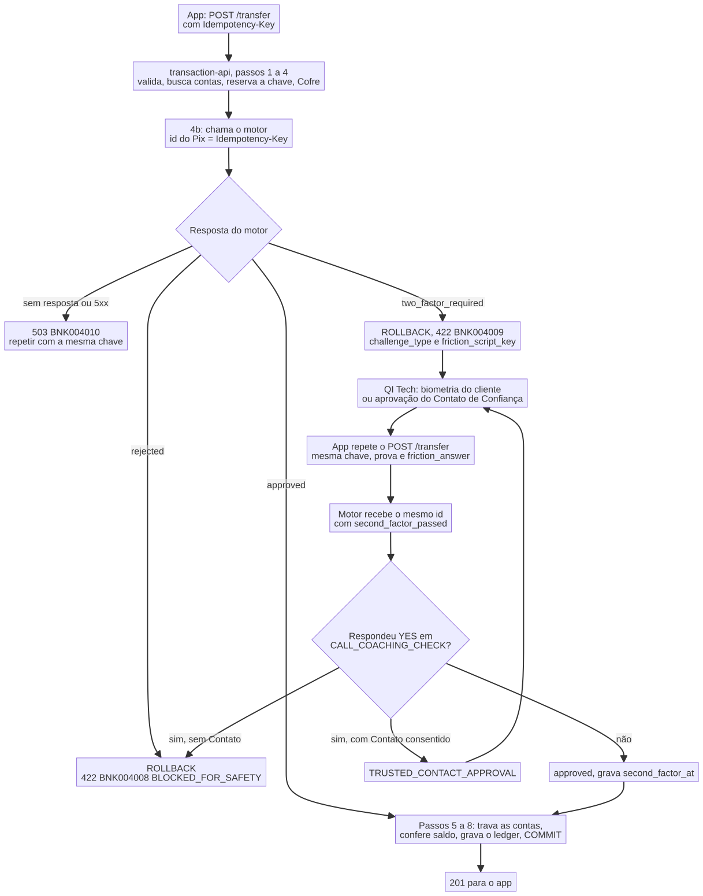
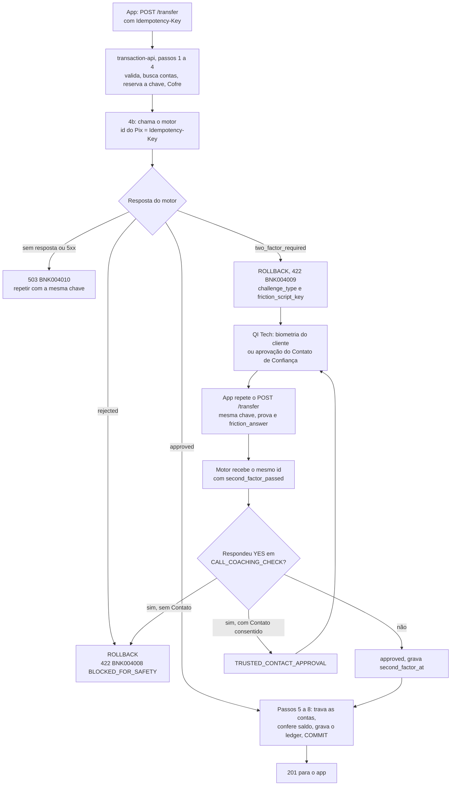
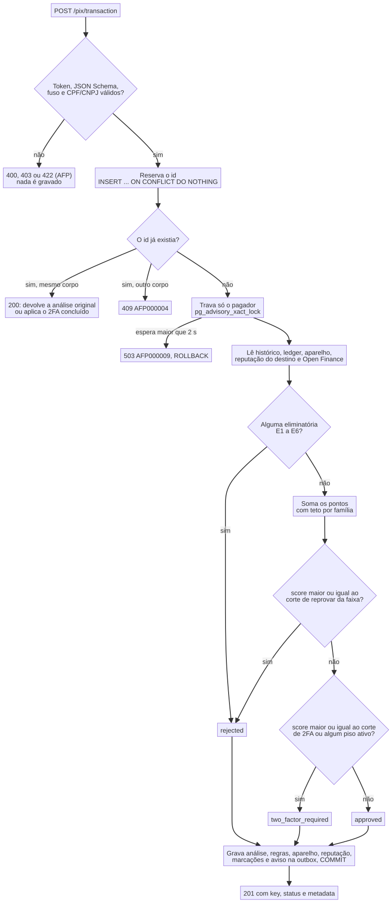
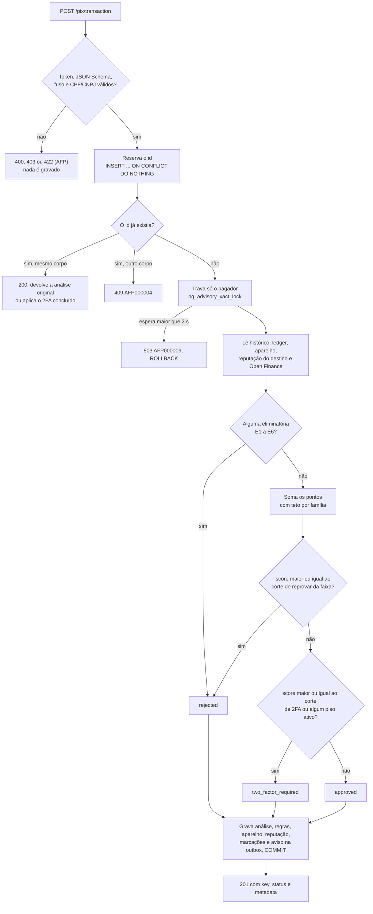
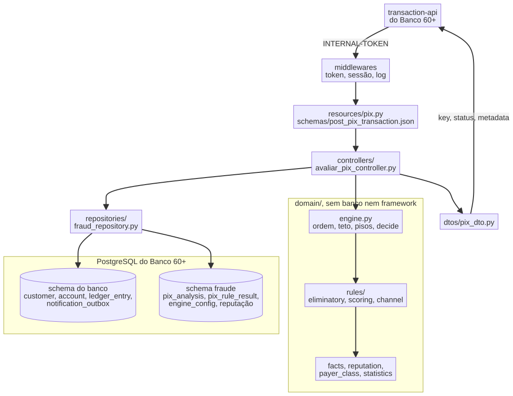
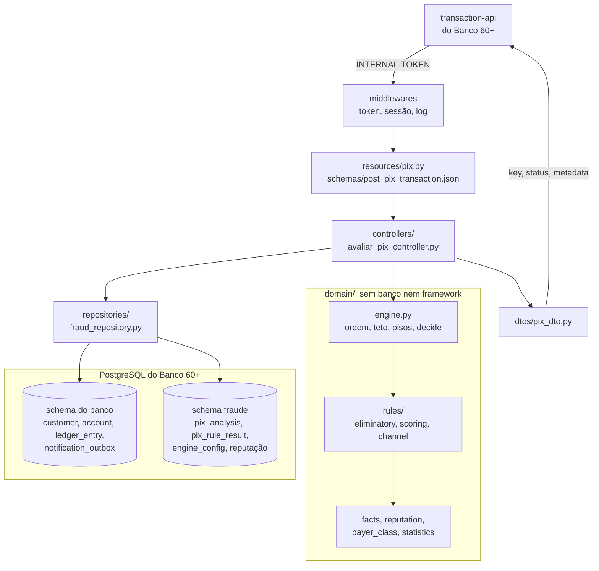
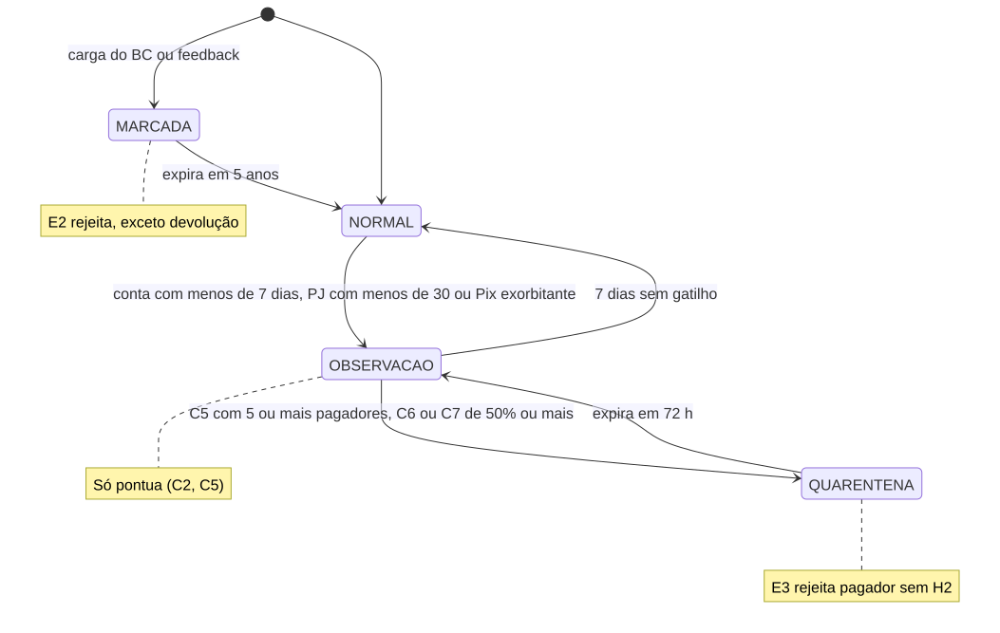
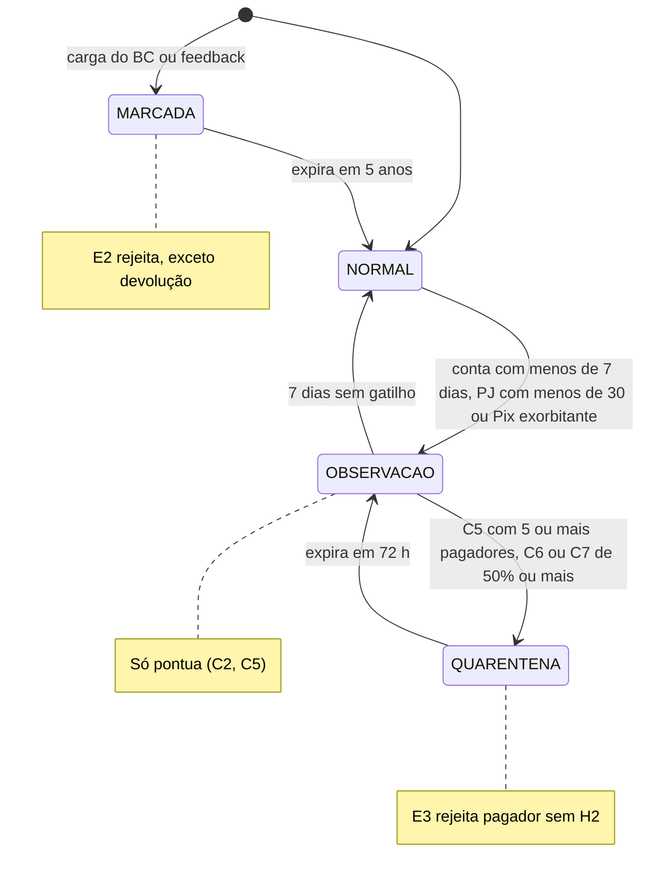

# Pix Seguro 60+

**Integrantes:** Isadora de Francisco, Henrique Manco e Vitor Robusti — Hackathon QI Tech 2026 · motor v0.1 (`engine_config` versão 1)

Antifraude de Pix para um banco de público 60+ (aposentados e pensionistas, renda estável, pouca fluência digital). A fricção só aparece onde há dúvida: aprovar é o padrão, 2FA é o meio-termo e reprovar exige risco claro.

> Tudo que não vem da pesquisa do time está marcado como **hipótese**. Os limiares se ancoram em limites reais do Banco Central, mas precisam de calibração (ver [Resultado do backtest](#resultado-do-backtest)). A API bancária sobre a qual o motor roda está descrita em [docs/banco-60.md](docs/banco-60.md).

## Como o motor de decisão funciona

O motor recebe o Pix **antes de o dinheiro sair** e responde `approved`, `two_factor_required` ou `rejected`. Tudo acontece em **uma passagem síncrona, sem chamada externa e sem analista**. Ele roda sobre o banco do Banco 60+ (RFC anterior) como o **passo 4b** do funil de transferência: depois do Cofre Antivícios e antes da trava das contas.

### Onde o motor entra no Banco 60+ (passo 4b) e o 2FA



<details>
<summary>Código Mermaid deste diagrama</summary>



</details>

A análise é gravada no schema `fraude` com `COMMIT` próprio, antes da trava das contas. O `ROLLBACK` da `transaction-api` não apaga o rastro de um Pix barrado.

### Fluxo de um Pix dentro do motor



<details>
<summary>Código Mermaid deste diagrama</summary>



</details>

Dentro da trava só há consulta ao banco e regras em memória; nada externo é chamado. Pagadores diferentes não esperam um pelo outro.

### Arquitetura do código

Seguimos a estrutura do Base Service. A regra de negócio fica em `src/domain/`, sem dependência de banco nem de framework.



<details>
<summary>Código Mermaid deste diagrama</summary>



</details>

O repositório é o único ponto que fala com o banco. O motor só lê as tabelas do Banco 60+ e só escreve no schema `fraude` e na `notification_outbox`.

### Garantias

1. **Decisão em uma passagem, sem chamada externa.** O Open Finance entra por carga assíncrona em tabela local, e o 2FA roda depois da resposta.
2. **Fricção só onde há dúvida.** Aprovar é o padrão.
3. **Cofre antes do score.** As eliminatórias rodam antes da pontuação.
4. **Nada em dobro.** O `id` do Pix é único, e reenviar devolve a análise existente.
5. **Histórico completo.** Cada Pix fica gravado com decisão, pontos e a evidência numérica de cada regra.
6. **Motivo claro sem ensinar o golpista.** O status é simples. Os motivos ficam na `metadata`, que só a `transaction-api` lê (com `INTERNAL-TOKEN`). O app recebe apenas a `customer_message_key`.

### Rotas

| Método | Caminho | O que faz |
| --- | --- | --- |
| `POST` | `/pix/transaction` | Analisa o Pix, grava e responde. `201` na primeira vez; `200` na repetição do mesmo corpo |
| `GET` | `/pix/transaction/{id}` | Devolve a análise gravada; `404` se não existe |
| `POST` | `/pix/feedback` | Grava o rótulo `{ transaction_id, is_fraud, reason }` (evolução: massa rotulada) |
| `GET` | `/health_check` | Diz se está de pé (`204`) |

Todas as rotas, menos `/health_check`, exigem o cabeçalho `INTERNAL-TOKEN`. Ausente ou errado, a resposta é `403 AFP000002`, e a comparação é feita em tempo constante. **Reprovar um Pix não é erro**: a resposta é `201` com `status: rejected`.

**Entrada.** Valores em centavos (inteiro ≥ 1) e `transaction_date` com fuso. Campos opcionais ausentes desligam a regra correspondente e entram em `metadata.inputs_missing`; a requisição não falha. `source.channel` aceita `internet`, `celular`, `computador`, `tablet` e `relogio`. O alias `app` é gravado como `celular`.

```json
{
  "id": "6f1c2b0e-0d7a-4f1e-9a51-2c1f8f0b9a10",
  "amount": 18900,
  "transaction_date": "2026-10-15T14:35:00-03:00",
  "type": "payment",
  "source_account": { "document_number": "529.982.247-25", "has_trusted_contact": true },
  "destination_account": {
    "document_number": "111.444.777-35",
    "participant": "60701190", "branch": "0001", "number": "4455667"
  },
  "source": {
    "channel": "app",
    "device_id": "cel-maria",
    "remote_access_detected": false,
    "call_in_progress": false
  }
}
```

**Saída.** Abaixo, uma resposta real do motor na massa sintética: o terceiro Pix de um fracionamento (três Pix logo abaixo de R$ 200 para destinos novos em pouco tempo). O score 80 passa o corte de 2FA da faixa A (45), mas fica abaixo do de reprovar (85).

```json
{
  "key": "75a4e5f9-d686-4a25-ba60-1955ec92a4c1",
  "status": "two_factor_required",
  "metadata": {
    "engine_version": 1,
    "score": 80,
    "value_band": "A",
    "thresholds": { "two_factor": 45, "reject": 85 },
    "rules_fired": [
      { "code": "G4", "points": 5, "evidence": { "channel": "celular", "segment": "mobile" } },
      { "code": "C1", "points": 15, "evidence": { "previous_pix_to_destination": 0 } },
      { "code": "M2", "points": 30, "evidence": { "ceiling_cents": 20000, "pix_near_ceiling": 3 } },
      { "code": "V2", "points": 30, "evidence": { "new_destinations_1h": 3 } }
    ],
    "floor_applied": [],
    "payer_class": "PF",
    "destination_status": "NORMAL",
    "destination_reputation": { "analyses_count": 0, "suspicious_ratio": 0.0 },
    "notify_trusted_contact": true,
    "customer_message_key": "CONFIRM_IDENTITY",
    "inputs_missing": ["geolocation", "destination_account.created_at"],
    "challenge_type": "BIOMETRIC_2FA",
    "friction_script_key": "CONFIRM_IDENTITY",
    "friction_params": {}
  }
}
```

## Regras

**Nenhum limiar fica fixo no código.** Todos os parâmetros abaixo são lidos de `fraude.engine_config` (versionado, com `active_from`), e cada análise grava a versão usada. A equipe de dados recalibra inserindo uma versão nova, sem refatorar. Os códigos seguem a pesquisa do time (E, D, G, K, C, P, M, V, O, R, H, X), mais F para os sinais do Open Finance.

### Eliminatórias (rodam antes do score; qualquer uma reprova)

| Regra | Lógica | Parâmetros | Por quê |
| --- | --- | --- | --- |
| **E1 Cofre Antivícios** | O MCC do CNPJ de destino (tabela `merchant`) está nos `blocked_mcc` da conta | padrão `7995` (apostas) | Garantia herdada do Banco 60+: o dinheiro não vai para a aposta que o cliente bloqueou. Quem recebe Pix não informa MCC, então lemos o cadastro do CNPJ |
| **E2 Destino marcado** | Destino com marcação `MARCADA` ativa e `type` diferente de `refund` | validade de 5 anos; flag `ENABLE_BCB_587_RULES` | Res. BCB 587 (publicada em 18/09/2026). Adotamos antes da vigência, com data de expiração na tabela |
| **E3 Quarentena** | Destino em `QUARENTENA` e pagador sem beneficiário de confiança (H2) | até 72 h | Espelho interno do bloqueio cautelar de até 72 h do BC (hipótese: o do BC é do lado recebedor) |
| **E4 Limite noturno** | PF (11 dígitos) ou MEI, das 20h às 6h (fuso `America/Sao_Paulo`), acima do teto, para destino sem pré-cadastro | teto R$ 1.000; pré-cadastro = Pix aprovado ao mesmo destino há 24 h ou mais; PJ só com `APPLY_NIGHT_LIMIT_PJ` | Res. BCB 142/2021. Sequestro-relâmpago acontece à noite, e o 60+ raramente opera nesse horário |
| **E5 Aparelho não conhecido** | Aparelho desconhecido ou em maturação: soma do dia acima do limite reprova; Pix acima do limite vira piso de 2FA | R$ 1.000/dia reprova; R$ 200/Pix piso de 2FA | Res. BCB 403/2024. Reprovamos só o acumulado, porque o neto pode ter dado um celular novo ao avô |
| **E6 Bets** | CNPJ de destino ativo em `fraude.bet_destination`, exceto `refund` | flag `ENABLE_BETS_BAN` | Proibição de Pix para bets. O CNPJ nunca entra na `evidence`; devoluções passam |

**Reconhecimento do MEI (E4).** É feito em memória, sem consulta externa, sobre o nome do titular de um documento de 14 dígitos:

1. normaliza o nome (maiúsculas, sem acento);
2. com sufixo de empresa (`LTDA`, `EIRELI`, `SLU`, `EPP`, `S/A`, `S.A.`), é PJ;
3. se termina com um CPF válido ou com a raiz de 8 dígitos do próprio CNPJ, é MEI;
4. senão, é PJ.

`SA` e `ME` soltos ficam fora da lista para não vetar sobrenomes como "Sá". É uma heurística, por isso fica atrás de uma flag (`ENABLE_MEI_AS_PF`).

### Pontuação

| Regra | Lógica | Parâmetros e pontos | Por quê |
| --- | --- | --- | --- |
| **D1 Estágio do aparelho** | Desconhecido (nunca visto para o pagador), maturando (visto há menos de 24 h) ou conhecido | +40 / +20 / 0 | Aparelho novo é um estágio, não um sim/não. Singapura segura ações de risco por 12 h; o OCBC, por 24 h |
| **D2 Aparelho compartilhado** | Mesmo `device_id` com 3 ou mais documentos em 7 dias | +35 | Contas laranja operadas do mesmo aparelho. Casal no mesmo tablet (2 CPFs) é normal no 60+ |
| **D3 Partida a frio** | Primeira transação do cliente (substitui a D1) | +5 | Sem histórico não dá para dizer que o aparelho é novo |
| **G1 Distância do usual** | Distância até a mediana dos locais dos últimos 90 dias (mín. 5 pontos) | > 100 km +15; > 500 km +25 | Conta tomada opera de outro lugar. A mediana resiste a uma viagem pontual |
| **G2 Deslocamento impossível** | Velocidade desde o último Pix geolocalizado | ≥ 100 km e ≥ 800 km/h, ou ≥ 20 km e ≥ 300 km/h: +35 e piso de 2FA; ignora pontos com precisão pior que 5 km ou com mais de 6 h | 800 km/h é o limite generoso de voo comercial; o nível de 300 km/h pega deslocamentos curtos que nenhum carro faz |
| **G4 Sem geolocalização** | Canal `celular` ou `tablet` sem `geolocation` | +5 | Muitos 60+ negam a permissão, por isso o peso é baixo |
| **K1 Canal incomum** | Segmento do canal (mobile, desktop, relógio) usado em menos de 10% das transações em 90 dias (mín. 5) | +10 | Troca de canal acompanha tomada de conta |
| **K2 Relógio** | Canal `relogio` acima de R$ 200 | piso de 2FA | A tela pequena não mostra o destinatário completo (hipótese) |
| **C1 Beneficiário novo** | Primeiro Pix concluído do par pagador–destino | +15 | Golpe de engenharia social sempre leva a um destino novo |
| **C2 Idade do destino** | Idade da conta de destino | < 7 d +30; < 30 d +20; < 90 d +5 | Conta jovem sugere laranja, mas cerca de 60% das mulas têm mais de 1 ano: nunca decide sozinha |
| **C5 Muitos pagadores** | Pagadores distintos para o destino em 24 h | ≥ 3 +15; ≥ 5 +25 | Mula recebe de várias vítimas |
| **C6 Repasse rápido** | O destino repassa 50% ou mais do que recebe em até 1 h | +25 | Na pesquisa, cerca de 53% do dinheiro de mula sai em 1 h |
| **C7 Reputação endógena** | Proporção de `rejected` + `two_factor_required` nas análises do destino (mín. 4) | ≥ 30% +15; ≥ 50% +30 | "Consórcio de um participante só": cada análise ensina a próxima |
| **C8 Teste e drenagem** | Pix de até R$ 10 a destino novo e, em até 72 h, Pix alto ao mesmo destino | alto = maior entre R$ 500 e 20× o teste; +30 e piso de 2FA | Pix de centavos valida a conta antes da drenagem |
| **P1 Valor fora do padrão** | Valor acima do maior entre o P95 de 90 dias e R$ 500 | acima +20; acima de 3× +30; com menos de 10 observações, acima de R$ 500: +10 | O percentil resiste a outlier; média e desvio-padrão não (ver abaixo) |
| **P2 Horário fora do padrão** | Hora (±1 h, circular) usada em menos de 5% das transações (mín. 10) | +10 | Cada cliente tem seu ritmo; complementa o corte fixo do BC |
| **M1 Acumulado** | Soma de 24 h acima de 3× o limiar da P1 | +20 | Pega a drenagem em várias parcelas |
| **M2 Fracionamento** | 3 ou mais Pix entre 80% e 100% de R$ 200 ou de R$ 1.000 em 24 h | +30 | Quebrar o valor para ficar abaixo do teto é fácil de contornar |
| **V1 Rajada** | Pix do pagador em 10 min (contando o atual) | ≥ 3 +25; ≥ 5 +40 | O 60+ raramente faz 3 Pix seguidos; automação ou controle remoto, sim |
| **V2 Destinos novos** | Destinos novos em 1 h | ≥ 3 +30 | Vítima conduzida a vários destinos |
| **O1 Origem recém-aberta** | Conta de origem com menos de 30 dias | +10 | Conta aberta para a fraude |
| **R1 Acesso remoto / ligação** | `remote_access_detected` ou `call_in_progress` verdadeiros | +30 cada; piso de 2FA | "Mão fantasma" e falso atendente |
| **R2 Automação no desktop** | Canal `internet` ou `computador` com sinal de robô em `source.interaction`: `is_robotic_movement`, cadência de digitação com desvio ≤ 15 ms ou `session_idle_then_burst` | +40 e piso de 2FA; com C1 ou V1, escala para `rejected` | Bots e acesso remoto drenam a sessão aberta. A telemetria inteira vai para a `evidence` |
| **F1 Valor frente à renda** (hipótese) | Valor acima da renda mensal (créditos `DEPOSIT` em 30 dias + Open Finance) | > 1× +15; > 2× +25 | Pix muito grande para uma renda estável é desvio |
| **F2 Saldo esvaziado** (hipótese) | Pix que consome 80% ou mais do saldo (conta + Open Finance) | +15 | Golpes de engenharia social esvaziam a reserva |
| **F3 Conta de passagem** (hipótese) | Depósito há menos de 30 min e Pix ≥ 90% dele para destino novo | +30 e piso de 2FA; +15 se o Open Finance mostra queda parecida em outro banco | O golpista faz o idoso trazer a economia de outro banco e a pulveriza |
| **H2 Beneficiário de confiança** | 3 ou mais Pix concluídos ao destino em 3 meses-calendário diferentes, valor dentro de ±20% da mediana do par | −25 (score nunca abaixo de 0); não vale para destino marcado ou em quarentena, nem com C8 | Reduz atrito de quem paga o aluguel todo mês. Exigir meses distintos dificulta o golpista construir confiança rápido |

### Racional das escolhas

- **Por que P95 e não média ± desvio-padrão.** Um valor atípico puxa as duas medidas, e no 60+ ele é comum (reforma, remédio, funeral). Com 17 Pix de R$ 200 e um de R$ 8.000, a média + 3 desvios chega a cerca de R$ 5.994, e uma fraude de R$ 5.900 passaria. O P95 fica em cerca de R$ 1.370, como comprova um teste unitário. Com poucos pontos o P95 também oscila, por isso o mínimo de 10 observações e o piso de R$ 500.
- **Teto por família.** Regras da mesma família tendem a contar o mesmo fato duas vezes, então a soma de cada uma é limitada antes de entrar no score. Os tetos são: aparelho (D1, D2, D3) 45, geografia (G1, G2, G4) 40, destino (C1, C2, C5–C8) 55, comportamento (K1, P1, P2, M1, M2, V1, V2) 60. Pontos negativos, R1, R2, O1 e F ficam fora do teto. Quando um teto age, a `metadata` traz `family_caps_applied`.
- **Reputação do destino.** Nenhum destino é rejeitado só por ser novo, porque o neto que abriu conta ontem é legítimo. Só a convergência com C5, C6 ou C7 leva à quarentena.



<details>
<summary>Código Mermaid deste diagrama</summary>



</details>

## Como as regras viram decisão

**Ordem:** (1) validação e idempotência → (2) eliminatórias E1 a E6 → (3) soma dos pontos com teto por família → (4) faixa de valor → (5) pisos → (6) gravação.

A decisão fica numa função única (`domain.engine.decide`):

1. alguma eliminatória dispara → `rejected`;
2. score ≥ corte de reprovar da faixa → `rejected`;
3. score ≥ corte de 2FA **ou** algum piso ativo → `two_factor_required`;
4. senão → `approved`.

| Faixa | Valor (limites inclusivos) | 2FA a partir de | Reprova a partir de |
| --- | --- | --- | --- |
| A | até R$ 200 | 45 | 85 |
| B | R$ 200,01 a R$ 1.000 | 35 | 75 |
| C | R$ 1.000,01 a R$ 5.000 | 30 | 65 |
| D | acima de R$ 5.000 | 25 | 55 |

A fronteira desce quando o valor sobe: o custo da fraude cresce com o valor, e o da fricção é quase constante. Os cortes de R$ 200 e R$ 1.000 seguem limites do BC. O de R$ 5.000 e os pontos são hipóteses.

**Quando pede 2FA mesmo com pouca pontuação (pisos):**
- E5, K2, C8, R1, R2, F3 e G2;
- **X1 Convergência:** 3 ou mais sinais fracos, entre 10 e 19 pontos cada (sinais de 5 pontos não contam);
- **X2 Valor alto a destino novo:** faixa D com C1.

**Exemplos** (cobertos por testes unitários):
- Pix de R$ 1.500 às 22:15 para destino sem pré-cadastro: a E4 dispara e o Pix é `rejected`, com `rules_fired: [E4]`.
- O mesmo Pix às 14:00, cliente em padrão, para conta aberta há 5 dias: C1 (+15) e C2 (+30) somam 45, acima do corte de 30 da faixa C. Resultado: `two_factor_required`.
- O aluguel de R$ 1.200 pago ao mesmo destino pela 4ª vez: C1 não dispara, a H2 tira 25 e o score fica em 0. Resultado: `approved`.
- Ligação em andamento num Pix pequeno para destino conhecido: score baixo, mas o piso da R1 leva a `two_factor_required`.

**Tipo de desafio e fricção** (na `metadata` quando há 2FA):
- `challenge_type` é `BIOMETRIC_2FA` (padrão, feito pela QI Tech) ou `TRUSTED_CONTACT_APPROVAL`. O segundo vale quando R1 (ligação), C1 e F2 convergem e o Contato de Confiança deu aceite (`approval_consent_at`).
- `friction_script_key` diz ao app qual pergunta fazer antes do 2FA, pela ordem R1, F3, C6, C5: `CALL_COACHING_CHECK`, `PASSTHROUGH_CHECK`, `MULE_DESTINATION_CHECK`; nos demais casos, `CONFIRM_IDENTITY`.
- O motor devolve só a chave e uma faixa qualitativa, nunca o limiar ou o número.

**Segundo fator.** A `transaction-api` reenvia o mesmo `id` com `second_factor_passed: true` e, se houve pergunta, `friction_answer` (`YES`, `NO` ou `SKIP`). Esses campos não entram no `request_hash`.
- O motor devolve a análise original como `approved`, sem recalcular, e grava `second_factor_at`.
- "Sim, há alguém no telefone" escala: vira `TRUSTED_CONTACT_APPROVAL` se há Contato consentido, ou `rejected` se não há.
- A escalada nunca relaxa: um `rejected` não vira `approved`.

**Aviso ao Contato de Confiança.** Com `rejected` ou `two_factor_required` e Contato cadastrado, o motor grava o aviso na `notification_outbox` com `transaction_id = NULL` e `analysis_id` preenchido, na mesma transação da análise. O `outbox-worker` do banco faz a entrega.

## Como rodar e testar

Sobe o banco e a API:

```bash
docker compose up -d --build
```

Roda os 83 testes (58 unitários do motor, 11 da API Pix e 14 da API bancária):

```bash
pytest
```

Gera a massa sintética (600 Pix pela API) e o relatório do backtest, em [docs/backtest-massa-sintetica.md](docs/backtest-massa-sintetica.md):

```bash
python scripts/massa_sintetica.py
```

```bash
python scripts/backtest.py
```

## Resultado do backtest

A massa tem 480 Pix legítimos de clientes 60+:
- aluguel recorrente, contas e família;
- uso de `tablet`, alias `app`, relógio e uso ocasional do computador.

E 120 golpes ou bloqueios:
- falsa central, mão fantasma, sequestro-relâmpago e mula;
- teste e drenagem, fracionamento e destino marcado;
- robô no desktop, bot no `internet` e bets.

| Métrica (RFC) | Meta | Resultado |
| --- | --- | --- |
| Pix em `two_factor_required` (todos) | entre 2% e 5% | **17,0% — fora da meta** |
| Legítimos reprovados | o menor possível | **0 de 480** |
| Legítimos com 2FA | o menor possível | 18,8% |
| `rejected` por eliminatória | só regras previstas | E2, E3, E4, E5 e E6, todas em golpes ou bets |
| Valor fraudulento contido | — | **97,3%** (R$ 132,8 mil de R$ 136,5 mil) |

| Tipologia | Interceptados | Principal regra |
| --- | --- | --- |
| Falsa central, sequestro-relâmpago, mão fantasma, mula, destino marcado, bets | 100% | R1, E4, E5, E3, E2, E6 |
| Robô no desktop (aparelho conhecido) e bot no `internet` | 100% | R2 com escalada (20 de 20), sem falso positivo nos 10 legítimos no desktop |
| Teste e drenagem | 50% dos Pix, 99,9% do valor | C8 pega a drenagem; o Pix de teste passa, por desenho |
| Fracionamento | 33% | M2 só dispara no terceiro Pix, por desenho |

**O que ainda precisa de calibração** (hipóteses a validar antes de produção):

- **P1 com histórico curto.** O idoso faz poucos Pix. Com menos de 10 observações, todo aluguel acima de R$ 500 ganha +10, e isso gera a maior parte do 2FA em legítimos.
- **C7 se retroalimenta.** Um 2FA que o cliente passou conta como "suspeito" para o destino. Locadores que recebem de vários inquilinos acabam pontuando.
- **Partida a frio.** No começo do histórico, D3 e C1 pesam em todo primeiro Pix para cada destino.
- **R2.** A massa não tem quem cola a chave Pix (cadência de digitação perto de zero sem ser robô). Esse é o principal risco de falso positivo no desktop.
- **K1.** Disparou só em legítimos. As vítimas fazem poucos Pix e não atingem o mínimo de 5 transações.
- **Limites da massa.** A massa sintética mede a coerência interna das regras, não a taxa real de fraude. As tipologias têm 5 a 30 casos, então um Pix muda o percentual em vários pontos.

## Códigos de erro

Todo erro tem `code`, `title`, `description`, `translation`, `request_id` e `errors` (`field`, `rule`, `message`), e nunca expõe a stack nem o documento completo.

| Código | Status | Quando |
| --- | --- | --- |
| `AFP000001` | 400 | Corpo, cabeçalho ou parâmetro fora do formato |
| `AFP000002` | 403 | `INTERNAL-TOKEN` ausente ou errado |
| `AFP000003` | 404 | Análise inexistente (`GET` ou feedback) |
| `AFP000004` | 409 | Mesmo `id` com corpo diferente |
| `AFP000005` | 422 | CPF ou CNPJ com dígitos verificadores inválidos |
| `AFP000006` | 400 | `transaction_date` sem fuso, inválida ou mais de 5 min no futuro |
| `AFP000007` | 422 | `channel` fora do enum |
| `AFP000008` | 400 | `amount` menor que 1 ou não inteiro |
| `AFP000009` | 503 | Espera pela trava do pagador passou do máximo; repita com o mesmo `id` |

## Modelo de dados

O motor não tem banco próprio: usa o PostgreSQL do Banco 60+. Ele **só lê** as tabelas do banco (`customer`, `account`, `blocked_mcc`, `merchant`, `trusted_contact`, `bank_transaction`, `ledger_entry`) e **escreve** no schema `fraude` e, para avisos, na `notification_outbox`. Nunca mexe em saldo nem em extrato.

| Tabela (`fraude.`) | Conteúdo |
| --- | --- |
| `pix_analysis` | Uma linha por Pix: `pix_id` único, `request_hash`, status, score, faixa, versão do motor, documentos em hash e máscara, canal, aparelho, geolocalização, `metadata` e campos do 2FA e da fricção |
| `pix_rule_result` | Regra, pontos e `evidence` (JSON) de cada regra disparada, para auditoria e backtest |
| `device_seen` | Aparelho × pagador com primeira e última vez visto (D1, D2, E5) |
| `destination_flag` | `OBSERVACAO`, `QUARENTENA` e `MARCADA`, com validade |
| `destination_reputation` | Contadores por destino (análises, reprovações, 2FA, pagadores em 24 h, repasse em 1 h), atualizados com `n = n + 1` |
| `bet_destination` | CNPJs de bets (E6) |
| `of_payer_profile` | Agregados do Open Finance (renda, saldo, consentimento), carregados fora da decisão |
| `engine_config` | Parâmetros versionados com `active_from` |
| `pix_feedback` | Rótulos de fraude (evolução) |
| `pix_shadow_result` | Score do modo sombra, que não altera a resposta (evolução) |

**Alterações no Banco 60+:**
- `notification_outbox` aceita `transaction_id` nulo e ganha `analysis_id`, com `CHECK` de que exatamente um dos dois está preenchido. Também ganha `UNIQUE (analysis_id, contact_id)` e um índice parcial `WHERE transaction_id IS NULL`, que é o filtro dos Pix barrados ou retidos.
- `trusted_contact` ganha `approval_consent_at`.
- `bank_transaction` ganha índices para o histórico do par pagador–destino.

## Premissas e fora do escopo

**Premissas:**
- **RFC Banco 60+.** É a especificação de produto do desafio. O motor é parametrizado para recalibrar sem refatorar quando houver dados de produção.
- **Res. BCB 587.** Ligada por padrão (`ENABLE_BCB_587_RULES`). Desligada, a E2 não rejeita.
- **MED 2.0.** Adotamos a obrigatoriedade em 02/02/2026, para ancorar a rastreabilidade (`id`, `destination_key` e evidência gravados).
- **MEI.** Reconhecido por heurística no nome, sem consulta à Receita. Pode errar nos dois sentidos.
- **Renda.** Assumimos que o benefício chega como crédito `DEPOSIT` no ledger.

**Fora do escopo:**
- tela, envio e verificação do 2FA e biometria (QI Tech);
- conexão com o Open Finance;
- entrega real do aviso (`outbox-worker`);
- liquidação externa, MED e estorno;
- modelo supervisionado (entra em modo sombra);
- regra de "nome parecido", porque o payload não traz o nome do recebedor;
- geolocalização de compras e IP, porque não passam pelo motor.

**Melhorias conhecidas:**
- Trocar o hash SHA-256 simples do CPF por HMAC com chave secreta. O espaço de CPFs é pequeno e o hash simples pode ser revertido por força bruta.
- Calibrar P1 e C7, conforme o backtest acima.
