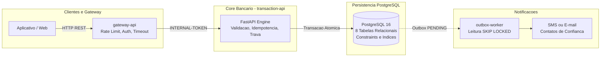
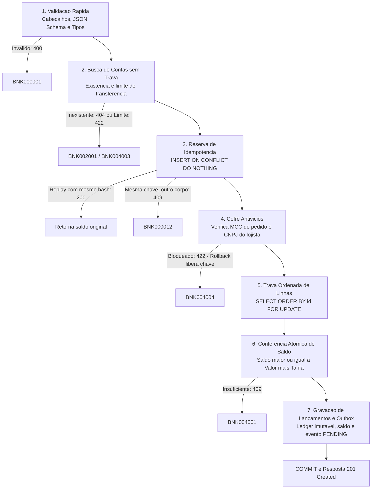
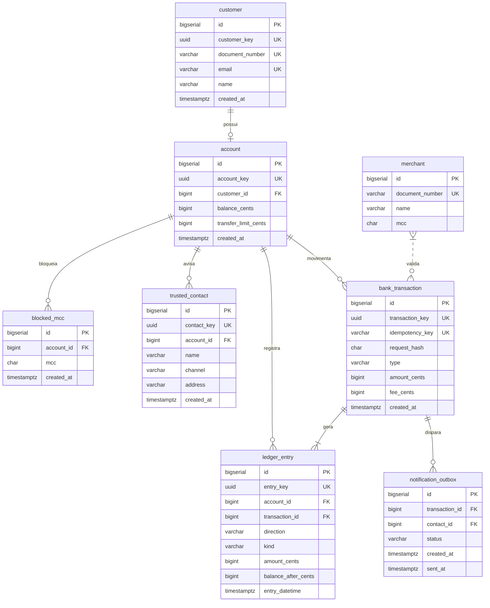

# BANCO 60+ | Core Bancário & Motor Antifraude Pix Seguro 60+


[](https://www.python.org/)
[](https://fastapi.tiangolo.com/)
[](https://www.postgresql.org/)
[](https://www.docker.com/)
[-success.svg?logo=pytest&logoColor=white)](https://docs.pytest.org/)
[-brightgreen.svg)](./docs/politica-resiliencia-sla-antifraude.md)
[](./LICENSE)

> **Documento Base:** RFC: BANCO 60+, com saldo protegido, Cofre Antivícios, Contato de Confiança e Motor Antifraude Pix Seguro 60+  
> **Autores da RFC:** Isadora de Francisco, Henrique Manco e Viitor Robusti  

---

## Sumário
1. [Contextualização e Proposta do Projeto](#1-contextualização-e-proposta-do-projeto)
2. [As Seis Garantias Fundamentais](#2-as-seis-garantias-fundamentais)
3. [Arquitetura da Solução e Decisões Técnicas](#3-arquitetura-da-solução-e-decisões-técnicas)
4. [Modelo de Dados (PostgreSQL — Schemas `public` e `fraude`)](#4-modelo-de-dados-postgresql)
5. [Passo a Passo de Instalação e Execução](#5-passo-a-passo-de-instalação-e-execução)
6. [Execução dos Testes Automatizados e Cobertura (123 Testes)](#6-execução-dos-testes-automatizados)
7. [Catálogo de Endpoints da API (Core Bancário + Antifraude Pix)](#7-catálogo-de-endpoints-da-api)
8. [Exemplos Práticos de Uso](#8-exemplos-práticos-de-uso)
9. [Matriz de Códigos de Erro (`BNK` e `AFP`)](#9-matriz-de-códigos-de-erro-bnk-e-afp)
10. [Motor Antifraude Pix Seguro 60+ (Regras, Banco de Dados e Telemetria)](#10-motor-antifraude-pix-seguro-60-regras-banco-de-dados-e-telemetria)
11. [Estrutura do Projeto](#11-estrutura-do-projeto)

---

## 1. Contextualização e Proposta do Projeto

O **BANCO 60+** é uma solução bancária concebida sob medida para aposentados e pensionistas com mais de 60 anos. Esse público reúne características financeiras muito específicas: possuem **renda estável e previsível**, porém enfrentam **baixa fluência digital**, tornando-se os alvos preferenciais de golpes de engenharia social, fraudes com cartões e compulsão por plataformas de apostas online (*bets*).

Para proteger o patrimônio desse público sem gerar atritos desnecessários, a plataforma foi estruturada em torno de três pilares de proteção:
1. **Saldo Rigorosamente Protegido:** Dinheiro mantido estritamente em números inteiros (centavos) com transações atômicas e serialização contra concorrência agressiva.
2. **Cofre Antivícios Integrado:** Bloqueio preventivo de categorias de risco (MCC `7995` - jogos de azar, apostas e loterias), validando tanto o código informado na compra quanto o cadastro oficial do lojista (CNPJ).
3. **Rede de Apoio Familiar (Contatos de Confiança):** Notificação em tempo real de até dois familiares por meio de eventos assíncronos (*Transactional Outbox Pattern*).

---

## 2. As Seis Garantias Fundamentais

A plataforma sustenta seis garantias inegociáveis formalizadas na RFC:

* 🛡️ **Saldo nunca negativo e igual ao extrato:** Mesmo sob corrida de requisições simultâneas. Se duas transferências de R$ 80,00 disputarem uma conta com saldo de R$ 100,00, a primeira é aprovada e a segunda é rejeitada com clareza.
* 🔁 **Nada em dobro (Idempotência Estrita):** Repetições de requisições causadas por oscilações de conectividade não debitam duas vezes. A idempotência é controlada por hash criptográfico canônico cobrindo rota, conta e corpo.
* 📜 **Extrato reconstrói o saldo:** Lançamento a lançamento em um *Ledger* contábil imutável (*append-only*).
* 🏷️ **Tarifa visível:** Toda transferência debita uma tarifa fixa de R$ 1,00 (`FEE`) como linha própria no extrato, nunca embutida silenciosamente no valor transferido.
* 🔒 **Cofre antes do dinheiro:** Operações com estabelecimentos bloqueados são interceptadas e recusadas antes de qualquer bloqueio de saldo ou movimento financeiro.
* 💬 **Motivo claro e seguro:** Todos os retornos de erro informam código de domínio (`BNK`), título, descrição em português e campo afetado, sem jamais expor *stack traces*, CPFs ou e-mails completos.

---

## 3. Arquitetura da Solução e Decisões Técnicas



### O Funil de 7 Passos das Operações Financeiras

Todo movimento de dinheiro atravessa um funil rigoroso em 7 etapas que filtra requisições inválidas antes de concorrer por travas de banco:



### Por que estas decisões foram tomadas:
* **Centavos inteiros (`BIGINT`) em vez de `FLOAT` ou `NUMERIC`:** Elimina erros de arredondamento inerentes a ponto flutuante ($0.1 + 0.2 \neq 0.3$) e evita overhead de conversão decimal sem perda de precisão contábil.
* **Trava ordenada (`ORDER BY id FOR UPDATE`):** Evita *deadlocks* em transferências simultâneas cruzadas entre contas ($A \to B$ e $B \to A$).
* **Outbox Pattern:** Desacopla a entrega de notificações (SMS/e-mail) da transação bancária, impedindo que falhas de rede em serviços externos travem o banco de dados.

---

## 4. Modelo de Dados (PostgreSQL)

O banco de dados é composto por **8 tabelas relacionais**, normalizadas e protegidas por restrições de integridade no próprio PostgreSQL:



---

## 5. Passo a Passo de Instalação e Execução

### Pré-requisitos
* [Docker Desktop](https://www.docker.com/products/docker-desktop/) instalado e em execução (com Docker Compose v2).
* Git instalado.

### 1. Clonar o repositório e entrar na pasta do projeto
```bash
git clone https://github.com/HenriqueJCManco/BootcampQITech.git
cd BootcampQITech/bootcamp-base-api
```

### 2. Subir os containers (API + PostgreSQL)
Com apenas um comando, o Docker Compose inicializa o banco de dados com todas as tabelas e sobe a aplicação FastAPI com recarregamento automático:

```bash
docker compose up --build -d
```

### 3. Verificar se o serviço está ativo
```bash
# Rota pública de identificação
curl -s http://localhost:3000/

# Rota pública de health check (deve retornar 204 No Content)
curl -s -i http://localhost:3000/health_check
```

---

## 6. Execução dos Testes Automatizados

A suíte automatizada conta com **123 testes (100% de aprovação e 0 warnings)**, cobrindo **100% do domínio de regras antifraude (`src/domain/`)**, validações de contrato JSON Schema, fluxos de segundo fator (2FA Biométrico e Social), *Transactional Outbox* e cenários de concorrência massiva multi-thread no banco de dados.

### Executar a suíte de testes via Docker (Recomendado):
Não é necessário instalar Python na máquina hospedeira:

```bash
docker compose --profile test run --rm test
```

> **Resultado esperado:** `123 passed in ~9.9s` (100% de sucesso).

### Executar localmente com Python e Relatório de Cobertura / Benchmark:
```powershell
# Criação e ativação do ambiente virtual
python -m venv .venv
.\.venv\Scripts\Activate.ps1

# Instalação das dependências de teste
pip install -r requirements-dev.txt

# Execução dos 123 testes + cobertura de 100% do domínio antifraude
pytest --cov=src/domain --cov-report=term-missing

# Execução do benchmark de latência etapa por etapa da API do motor
python scripts/benchmark_telemetry.py

# Inspeção das tabelas e linhas atuais do PostgreSQL
python scripts/inspect_db.py
```

---

## 7. Catálogo de Endpoints da API

Todas as rotas (exceto `/` e `/health_check`) exigem o cabeçalho de autenticação interna comparado em tempo constante (`hmac.compare_digest`):
```http
INTERNAL-TOKEN: default_token
```

| Método | Rota | Cabeçalhos Obrigatórios | Descrição | Status Sucesso |
| :--- | :--- | :--- | :--- | :---: |
| `GET` | `/` | — | Identificação da API | `200` |
| `GET` | `/health_check` | — | Checagem de saúde da aplicação | `204` |
| `POST` | `/customer` | `INTERNAL-TOKEN` | Cadastra cliente PF ou PJ | `201` |
| `GET` | `/customer/{customer_key}` | `INTERNAL-TOKEN` | Consulta cliente por chave UUID | `200` |
| `POST` | `/account` | `INTERNAL-TOKEN` | Cria conta (saldo 0 e MCC 7995 bloqueado) | `201` |
| `GET` | `/account/{account_key}` | `INTERNAL-TOKEN` | Consulta saldo, limites e MCCs bloqueados | `200` |
| `PUT` | `/account/{account_key}/blocked_mcc` | `INTERNAL-TOKEN` | Atualiza lista de MCCs bloqueados do Cofre | `200` |
| `POST` | `/account/{account_key}/trusted_contact` | `INTERNAL-TOKEN` | Cadastra contato de confiança (máx. 2) | `201` |
| `POST` | `/account/{account_key}/deposit` | `INTERNAL-TOKEN`, `Idempotency-Key` | Realiza depósito (em centavos) | `201` / `200` |
| `POST` | `/account/{account_key}/purchase` | `INTERNAL-TOKEN`, `Idempotency-Key` | Realiza compra com cartão (valida Cofre) | `201` / `200` |
| `POST` | `/transfer` | `INTERNAL-TOKEN`, `Idempotency-Key` | Transfere valores com tarifa de R$ 1,00 | `201` / `200` |
| `GET` | `/account/{account_key}/statement` | `INTERNAL-TOKEN` | Extrato paginado (`limit`, `page`) | `200` |
| `POST` | `/pix/transaction` | `INTERNAL-TOKEN` | Avalia Pix no Motor Antifraude 60+ (e processa 2FA em replay) | `201` / `200` |
| `GET` | `/pix/transaction/{id}` | `INTERNAL-TOKEN` | Consulta resultado e metadados de uma análise Pix | `200` |
| `POST` | `/pix/feedback` | `INTERNAL-TOKEN` | Registra feedback de fraude/legítimo sobre um Pix avaliado | `201` |

---

## 8. Exemplos Práticos de Uso

### 1. Cadastrar um Cliente (com CPF ou CNPJ formatado)
```bash
curl -X POST http://localhost:3000/customer \
  -H "INTERNAL-TOKEN: default_token" \
  -H "Content-Type: application/json" \
  -d '{
    "name": "Sebastião da Silva",
    "email": "sebastiao@exemplo.com",
    "document_number": "529.982.247-25"
  }'
```

### 2. Abrir uma Conta
```bash
curl -X POST http://localhost:3000/account \
  -H "INTERNAL-TOKEN: default_token" \
  -H "Content-Type: application/json" \
  -d '{
    "customer_key": "<UUID_DO_CLIENTE>",
    "transfer_limit_cents": 100000
  }'
```

### 3. Cadastrar Contato de Confiança (Máximo 2)
```bash
curl -X POST http://localhost:3000/account/<UUID_DA_CONTA>/trusted_contact \
  -H "INTERNAL-TOKEN: default_token" \
  -H "Content-Type: application/json" \
  -d '{
    "name": "Mariana da Silva (Filha)",
    "channel": "EMAIL",
    "address": "mariana.filha@exemplo.com"
  }'
```

### 4. Realizar Depósito Idempotente (R$ 500,00)
```bash
curl -X POST http://localhost:3000/account/<UUID_DA_CONTA>/deposit \
  -H "INTERNAL-TOKEN: default_token" \
  -H "Idempotency-Key: dep-001-abc" \
  -H "Content-Type: application/json" \
  -d '{
    "amount_cents": 50000
  }'
```

### 5. Realizar Transferência com Tarifa (R$ 100,00 + R$ 1,00 de tarifa)
```bash
curl -X POST http://localhost:3000/transfer \
  -H "INTERNAL-TOKEN: default_token" \
  -H "Idempotency-Key: trf-001-xyz" \
  -H "Content-Type: application/json" \
  -d '{
    "from_account_key": "<UUID_CONTA_ORIGEM>",
    "to_account_key": "<UUID_CONTA_DESTINO>",
    "amount_cents": 10000
  }'
```

### 6. Consultar Extrato Paginado
```bash
curl -X GET "http://localhost:3000/account/<UUID_DA_CONTA>/statement?limit=10&page=0" \
  -H "INTERNAL-TOKEN: default_token"
```

### 7. Avaliar Transação Pix no Motor Antifraude (`POST /pix/transaction`)
```bash
curl -X POST http://localhost:3000/pix/transaction \
  -H "INTERNAL-TOKEN: default_token" \
  -H "Content-Type: application/json" \
  -d '{
    "id": "pix-demo-001",
    "amount": 30000,
    "transaction_date": "2026-10-18T14:00:00-03:00",
    "type": "payment",
    "source": {
      "channel": "app",
      "device_id": "device-maria-01",
      "geolocation": {"latitude": -23.5505, "longitude": -46.6333, "accuracy_m": 12.0},
      "remote_access_detected": false,
      "call_in_progress": true
    },
    "source_account": {
      "document_number": "529.982.247-25",
      "has_trusted_contact": true,
      "owner": {"name": "Sebastião da Silva"}
    },
    "destination_account": {
      "document_number": "111.444.777-35",
      "participant": "60701190",
      "branch": "0001",
      "number": "12345678",
      "owner": {"name": "Destinatário"}
    }
  }'
```

---

## 9. Matriz de Códigos de Erro (`BNK` e `AFP`)

Todas as respostas de erro retornam um envelope padronizado contendo `title`, `description`, `translation` (em português), `code`, `request_id` e lista de `errors`:

```json
{
  "title": "Operation blocked by MCC protection",
  "description": "The operation matches an MCC blocked for this account.",
  "translation": "A operação corresponde a um MCC bloqueado para esta conta.",
  "code": "BNK004004",
  "request_id": "c1f7a0b5-4b12-4f6c-8e43-982e5b7190c1",
  "errors": []
}
```

### 9.1 Códigos do Core Bancário (`BNK`)

| HTTP Status | Código BNK | Cenário de Ocorrência |
| :---: | :---: | :--- |
| `400` | `BNK000001` | Corpo, cabeçalho ou parâmetro de consulta fora do formato esperado |
| `403` | `BNK000002` | `INTERNAL-TOKEN` ausente ou incorreto |
| `400` | `BNK000011` | Cabeçalho `Idempotency-Key` ausente em operação de dinheiro |
| `409` | `BNK000012` | Mesma chave de idempotência reenviada com corpo diferente |
| `404` | `BNK000404` | Rota ou recurso HTTP inexistente |
| `409` | `BNK001001` | Documento (CPF/CNPJ) ou e-mail já cadastrado |
| `422` | `BNK001002` | CPF ou CNPJ com dígitos verificadores inválidos |
| `404` | `BNK001003` | Cliente não encontrado |
| `404` | `BNK002001` | Conta não encontrada |
| `409` | `BNK002002` | Cliente já possui conta cadastrada |
| `400` | `BNK002003` | Limite por transferência menor que 1 centavo |
| `400` | `BNK002004` | Lista de MCCs fora do formato (deve conter 4 dígitos por MCC) |
| `409` | `BNK003001` | Limite de contatos de confiança atingido (máximo de 2 por conta) |
| `409` | `BNK003002` | Contato de confiança com mesmo endereço já cadastrado na conta |
| `409` | `BNK004001` | Saldo insuficiente (considera valor + tarifa na transferência) |
| `422` | `BNK004002` | Transferência para a mesma conta (origem igual ao destino) |
| `422` | `BNK004003` | Valor da transferência excede o limite configurado na conta |
| `422` | `BNK004004` | Operação bloqueada pelo Cofre Antivícios (MCC 7995 / apostas) |
| `422` | `BNK004005` | CNPJ do lojista com dígitos verificadores inválidos |
| `400` | `BNK004006` | Valor monetário menor que 1 centavo |
| `503` | `BNK004007` | Timeout ao aguardar trava de linha no banco de dados |

### 9.2 Códigos do Motor Antifraude Pix (`AFP`)

| HTTP Status | Código AFP | Cenário de Ocorrência |
| :---: | :---: | :--- |
| `400` | `AFP000001` | Corpo, cabeçalho ou parâmetro da requisição Pix fora do schema esperado |
| `403` | `AFP000002` | Cabeçalho `INTERNAL-TOKEN` ausente ou inválido nas rotas `/pix/*` |
| `404` | `AFP000003` | Nenhuma análise Pix encontrada para o `id` consultado |
| `409` | `AFP000004` | Conflito de idempotência: mesmo `id` de Pix reenviado com payload diferente |
| `422` | `AFP000005` | Dígitos verificadores inválidos em `source_account.document_number` ou `destination_account.document_number` |
| `400` | `AFP000006` | `transaction_date` sem fuso horário (timezone) ou no futuro (`> 5 min`) |
| `422` | `AFP000007` | `source.channel` fora dos canais aceitos (`internet`, `celular`, `computador`, `tablet`, `relogio`, `app`) |
| `400` | `AFP000008` | `amount` inválido (não inteiro, booleano ou menor que 1 centavo) |
| `503` | `AFP000009` | Timeout (`> 2s`) ao aguardar `pg_advisory_xact_lock` do pagador concorrente |

---

## 10. Motor Antifraude Pix Seguro 60+ (Regras, Banco de Dados e Telemetria)

O **Motor Antifraude Pix Seguro 60+** foi projetado com **Arquitetura Hexagonal / Domínio Puro**: a função [`evaluate(context, config)`](./src/domain/engine.py) opera 100% em memória sobre *snapshots* imutáveis (`@dataclass(frozen=True)`), enquanto todos os pesos, janelas temporais, tetos de família e *feature flags* são parametrizados no banco na tabela `fraude.engine_config`.

### 10.1 Catálogo das 26 Regras, Tetos por Família e Pisos de 2FA

| Família / Teto | Código | Regra | Efeito / Pontuação (`engine_config v1`) |
| :--- | :---: | :--- | :--- |
| **Eliminatórias** *(Rejeição Imediata)* | `E1` | Cofre Antivícios por MCC | `REJECTED` se o `merchant_mcc` do destinatário estiver bloqueado na conta |
| | `E2` | Destino Marcado (`MARCADA`) | `REJECTED` em pagamentos (exceto `refund`) sob flag BCB 587 |
| | `E3` | Quarentena Policial (`QUARENTENA`) | `REJECTED` se o destinatário não for beneficiário de confiança (`H2`) |
| | `E4` | Limite Noturno PF e MEI (`20h–06h`) | `REJECTED` acima de R$ 1.000,00 para destinatário não cadastrado há $\ge 24\text{h}$ |
| | `E5` | Aparelho Desconhecido / Maturando | `REJECTED` se soma diária no aparelho $> \text{R\$ } 1.000$; **Piso de 2FA** se Pix $> \text{R\$ } 200$ |
| | `E6` | Banimento Regulatório de *Bets* | `REJECTED` se CNPJ destino constar ativo em `fraude.bet_destination` (exceto `refund`) |
| **Aparelho** *(Teto: 45 pts)* | `D1` | Estágio de Maturação do Aparelho | `+40` (desconhecido) ou `+20` (maturando $< 24\text{h}$) |
| | `D2` | Aparelho Compartilhado | `+35` se $\ge 3$ documentos distintos usaram o aparelho em 7 dias |
| | `D3` | *Cold Start* (Primeiro Pix) | `+5` quando pagador não possui histórico anterior (suprime `D1` e `E5`) |
| **Geografia** *(Teto: 40 pts)* | `G1` | Distância da Mediana Habitual (90d) | `+25` ($> 500\text{ km}$) ou `+15` ($> 100\text{ km}$) |
| | `G2` | Deslocamento Impossível (Teletransporte) | `+35` e **Piso de 2FA** ($\ge 100\text{ km}$ a $\ge 800\text{ km/h}$ ou $\ge 20\text{ km}$ a $\ge 300\text{ km/h}$) |
| | `G4` | Geolocalização Ausente em Mobile | `+5` em `celular` ou `tablet` sem coordenadas GPS |
| **Destino** *(Teto: 55 pts)* | `C1` | Novo Beneficiário | `+15` se nunca houve Pix aprovado e liquidado para a `destination_key` |
| | `C2` | Idade da Conta Destino | `+30` ($< 7\text{d}$), `+20` ($< 30\text{d}$) ou `+5` ($< 90\text{d}$) |
| | `C5` | Muitos Pagadores em 24h (Conta Mula) | `+25` ($\ge 5$ pagadores) ou `+15` ($\ge 3$ pagadores) + script `MULE_DESTINATION_CHECK` |
| | `C6` | Repasse Rápido em 1h (*Fast-Forward*) | `+25` se o destino repassou $\ge 50\%$ do que recebeu na última hora |
| | `C7` | Reputação Endógena Suspeita | `+30` ($\ge 50\%$ suspeitas) ou `+15` ($\ge 30\%$ suspeitas) com $\ge 4$ análises |
| | `C8` | Pix Teste Seguido de Drenagem (72h) | `+30` e **Piso de 2FA** (teste $\le \text{R\$ } 10$ seguido de Pix $\ge \max(\text{R\$ } 500, 20\times \text{teste})$) |
| **Comportamento** *(Teto: 60 pts)* | `K1` | Canal Incomum (Segmento 90d) | `+10` se o segmento (`mobile`/`desktop`/`relogio`) representa $< 10\%$ do histórico |
| | `P1` | Valor Atípico Acima do Percentil 95 | `+30` ($> 3\times \text{P95}$), `+20` ($> \text{P95}$) ou `+10` ($> \text{R\$ } 500$ sem histórico) |
| | `P2` | Horário Incomum no Histograma | `+10` se a janela de $\pm 1\text{h}$ tem $< 5\%$ das observações históricas |
| | `M1` | Acumulado em 24 Horas | `+20` se a soma em 24h ultrapassar $3\times$ o limiar P95 |
| | `M2` | Fracionamento (*Smurfing* perto do Teto) | `+30` se houver $\ge 3$ Pix em 24h entre $80\%$ e $100\%$ dos tetos (R$ 200 ou R$ 1.000) |
| | `V1` | Rajada de Pix em 10 Minutos (*Burst*) | `+40` ($\ge 5$ Pix em 10 min) ou `+25` ($\ge 3$ Pix em 10 min) |
| | `V2` | Pulverização para Novos Destinos (1h) | `+30` se enviar para $\ge 3$ destinos inéditos na última hora |
| **Fora do Teto** *(Risco Direto & Bônus)* | `K2` | Relógio Inteligente (*Smartwatch*) | `0 pts` e **Piso de 2FA** para Pix $> \text{R\$ } 200,00$ no canal `relogio` |
| | `O1` | Conta Origem Recente | `+10` se a conta pagadora tiver menos de 30 dias |
| | `R1` | Acesso Remoto ou Ligação em Curso | `+30` (acesso remoto) + `+30` (ligação ativa) + **Piso de 2FA** (`CALL_COACHING_CHECK`) |
| | `R2` | Automação / Bot em Canal Desktop | `+40` e **Piso de 2FA**; **escala para `REJECTED`** quando combinada com `C1` ou `V1` |
| | `F1` | Valor vs. Renda Mensal (Local + OF) | `+25` ($> 2\times$ renda 30d) ou `+15` ($> 1\times$ renda 30d) |
| | `F2` | Drenagem de Saldo ($\ge 80\%$) | `+15` se o Pix consumir $\ge 80\%$ do saldo somado (Conta Local + Open Finance) |
| | `F3` | Conta de Passagem (*Pass-Through* 30m) | `+30` (`+15` reforço de queda no Open Finance) + **Piso de 2FA** (`PASSTHROUGH_CHECK`) |
| | `H2` | Beneficiário de Confiança (Recorrente) | **`-25`** ($\ge 3$ Pix em $\ge 3$ meses distintos dentro de $\pm 20\%$ da mediana, sem `C8`/marcação) |
| **Pisos Globais** | `X1` | Convergência de Sinais Fracos | **Piso de 2FA** se $\ge 3$ regras pontuarem entre `10` e `19` pontos brutos |
| | `X2` | Alto Valor para Novo Destinatário | **Piso de 2FA** para qualquer Pix na **Faixa D** ($> \text{R\$ } 5.000,00$) com `C1` |

---

### 10.2 O que o Motor Puxa do Banco de Dados e Valores Reais das Tabelas

Em cada chamada `POST /pix/transaction`, o [`FraudRepository`](./src/repositories/fraud_repository.py) consulta e atualiza as seguintes tabelas nos schemas `public` e `fraude`:

1. **`fraude.engine_config` (Leitura):** Carrega a versão ativa onde `active_from <= transaction_date` (`version = 1`, `active_from = '2026-01-01T00:00:00Z'`), contendo todas as faixas (`A` até R$ 200, `B` até R$ 1.000, `C` até R$ 5.000, `D` acima de R$ 5.000), pesos e flags.
2. **`fraude.bet_destination` (Leitura — Regra `E6`):** Verifica se o CNPJ do destinatário consta ativo na lista regulatória de apostas:
   | `cnpj` | `razao_social` | `source` | `active` |
   | :--- | :--- | :--- | :---: |
   | `99000001000101` | `APOSTA FICTICIA UM LTDA` | `seed_demo` | `true` |
   | `99000002000148` | `BET FICTICIA DOIS LTDA` | `seed_demo` | `true` |
   | `99000003000192` | `CASSINO FICTICIO TRES LTDA` | `seed_demo` | `true` |
3. **Histórico e Perfil do Pagador (Leitura — janela de 125 dias):**
   * `fraude.pix_analysis` + `public.bank_transaction`: histórico de Pix anteriores do `source_hash` (valores, horários, coordenadas GPS, canal, `device_id` e liquidação);
   * `public.account`, `public.blocked_mcc`, `public.trusted_contact`, `public.ledger_entry` e `fraude.of_payer_profile`: saldo atual, data de abertura da conta, MCCs bloqueados no Cofre, consentimento do Contato de Confiança (`approval_consent_at`), lançamentos contábeis (`DEPOSIT`/`TRANSFER`) e saldos/rendas externos via Open Finance.
4. **Tabelas de Estado Pré-Calculadas (Leitura e Escrita Atômica via `ON CONFLICT DO UPDATE`):**
   * **`fraude.destination_reputation`** (acumula análises, reprovações, 2FA, pagadores em 24h e taxa de repasse em 1h):
     | `destination_key` (SHA-256) | `analyses_count` | `rejected_count` | `two_factor_count` | `payers_24h` | `forwarded_ratio_1h` |
     | :--- | :---: | :---: | :---: | :---: | :---: |
     | `f4f2c9f1b50cd3a5...f3a6a` | `60` | `56` | `2` | `1` | `0.0000` |
     | `596639d67d941368...06f4d` | `1` | `1` | `0` | `1` | `0.0000` |
   * **`fraude.device_seen`** (controla a primeira/última aparição de cada aparelho por pagador e compartilhamento `D2`):
     | `device_id` | `source_hash` (SHA-256) | `first_seen` | `last_seen` | `tx_count` |
     | :--- | :--- | :---: | :---: | :---: |
     | `device-bench-01` | `ec8fcc450d86eb39...6528` | `2026-10-18 08:42:00Z` | `2026-10-18 08:42:03Z` | `60` |
     | `device-headless-chrome-01` | `b217f82798b7bbd4...398d` | `2026-10-18 08:40:55Z` | `2026-10-18 08:40:55Z` | `1` |
5. **Auditoria de Análises e Regras (`fraude.pix_analysis` e `fraude.pix_rule_result`):**
   * Amostra de linhas reais gravadas em `fraude.pix_analysis`:
     | `id` | `pix_id` | `status` | `score` | `value_band` | `amount_cents` | `channel` | `customer_message_key` |
     | :---: | :--- | :---: | :---: | :---: | :---: | :---: | :--- |
     | `106` | `PIX-HTTP-d56fb67352a84b19...` | `rejected` | `120` | `A` | `17900` (R$ 179,00) | `celular` | `BLOCKED_FOR_SAFETY` |
     | `102` | `PIX-HTTP-052d9c3439a74ce3...` | `rejected` | `90` | `A` | `17800` (R$ 178,00) | `celular` | `BLOCKED_FOR_SAFETY` |
   * Amostra de linhas reais gravadas em `fraude.pix_rule_result` (para `analysis_id = 106`):
     | `id` | `analysis_id` | `rule_code` | `points` | `evidence` (JSONB) |
     | :---: | :---: | :---: | :---: | :--- |
     | `207` | `106` | `D1` | `20` | `{"device_stage": "maturing"}` |
     | `208` | `106` | `C7` | `30` | `{"analyses": 59, "ratio": 0.9661}` |
     | `209` | `106` | `V1` | `40` | `{"pix_10min": 60}` |
     | `210` | `106` | `R1` | `30` | `{"channel": "celular", "call_in_progress": true}` |

---

### 10.3 Tempo Gasto em Todo o Processo da API do Motor (Benchmark Real)

Medição obtida com [`scripts/benchmark_telemetry.py`](./scripts/benchmark_telemetry.py) sobre 30 transações sequenciais contra o PostgreSQL:

| Etapa do Processo (`AvaliarPixController`) | Mínimo (ms) | Mediana / P50 (ms) | Média (ms) | P95 (ms) | Máximo (ms) | % do Tempo (P50) |
| :--- | :---: | :---: | :---: | :---: | :---: | :---: |
| **1. Normalização, Validação e Hash SHA-256** (`_normalize`, `_validate`, `_request_hash`) | `0.094` | **`0.123`** | `0.134` | `0.183` | `0.315` | **0.4%** |
| **2. Busca de Contas Origem/Destino** (`_find_account`) | `3.400` | **`3.971`** | `5.887` | `5.855` | `55.411` | **13.1%** |
| **3. Reserva de Idempotência** (`reserve_analysis` — `INSERT ON CONFLICT`) | `2.118` | **`2.639`** | `2.948` | `3.855` | `10.176` | **8.7%** |
| **4. Trava por Pagador** (`_lock_payer` — `pg_advisory_xact_lock` com timeout `2s`) | `0.776` | **`1.042`** | `1.219` | `1.883` | `2.021` | **3.4%** |
| **5. Carregamento de Snapshots** (`load_payer_snapshot`, `load_destination_snapshot`, `load_device_snapshot`) | `7.826` | **`10.809`** | `11.077` | `13.601` | `23.491` | **35.6%** |
| **6. Avaliação Pura do Motor de Regras** (`evaluate(context, config)` — 26 regras em memória) | `0.193` | **`0.271`** | `0.478` | `0.364` | `6.721` | **0.9%** |
| **7. Persistência, Reputação, Outbox e Commit** (`persist_analysis` + `commit`) | `9.166` | **`11.297`** | `11.251` | `12.368` | `18.951` | **37.2%** |
| **Total Interno do Controller** (`AvaliarPixController.avaliar`) | `26.093` | **`30.354`** | `33.001` | `33.217` | `116.758` | **100%** |
| **HTTP End-to-End (`POST /pix/transaction` — Nova Análise)** | `35.179` | **`38.369`** | `40.017` | `42.967` | `85.709` | **SLA < 300 ms (Folga de 87%)** |
| **Replay Idempotente (`200 OK` — Mesma chave e corpo)** | `6.174` | **`7.486`** | `7.749` | `10.115` | `10.660` | **SLA < 300 ms** |
| **Replay de Confirmação 2FA (`second_factor_passed=True`)** | `6.094` | **`8.225`** | `8.769` | `12.363` | `16.125` | **SLA < 300 ms** |

---

### 10.4 Mapa da Suíte de Testes e Cobertura de 100% do Domínio

| Suíte / Arquivo | Qtd. Testes | Base Acionada | O que é verificado |
| :--- | :---: | :---: | :--- |
| [`tests/unit/test_rules_catalog.py`](./tests/unit/test_rules_catalog.py) | `35` | Memória (`conftest.py` lê seed de `database.sql`) | Cobertura unitária exaustiva de todas as regras `E1..E5`, `D1..D3`, `G1..G2`, `C2..C8`, `P1..P2`, `M1..M2`, `V2`, `O1`, `K1..K2`, `R1`, `X2`, `F1..F3`, transições de reputação e funções de identidade/estatística |
| [`tests/unit/test_engine_improvements.py`](./tests/unit/test_engine_improvements.py) | `24` | Memória | Fronteiras inclusivas das faixas `A..D`, função `decide`, banimento de bets (`E6`), níveis de teletransporte (`G2`), teto por família (`capped_score`) e piso `X1` |
| [`tests/unit/test_pix_validation.py`](./tests/unit/test_pix_validation.py) | `14` | Memória | JSON Schema `post_pix_transaction.json`, mapeamento de erros `AFP`, normalização do alias `app` $\to$ `celular` e invariância do `request_hash` no 2FA |
| [`tests/unit/test_fraud_engine.py`](./tests/unit/test_fraud_engine.py) | `12` | Memória | P95 resistente a outlier, limite noturno (`E4`), aluguel recorrente (`H2`), teste+drenagem (`C8`), rajada (`V1`), 2FA Social (`TRUSTED_CONTACT_APPROVAL`) e reconhecimento de MEI |
| [`tests/unit/test_channel_rules.py`](./tests/unit/test_channel_rules.py) | `8` | Memória | Geolocalização ausente (`G4`), chamada ativa (`R1`), automação robótica desktop (`R2`) com escalada para `rejected` e mudança de segmento (`K1`) |
| [`tests/integration/fraud/test_fraud_outbox.py`](./tests/integration/fraud/test_fraud_outbox.py) | `11` | PostgreSQL Real (`DbUtils.rollback()`) | Gravação de Pix retido na `notification_outbox`, idempotência (`201` vs `200` vs `409`), escalada de `friction_answer=YES`, aprovação com `second_factor_passed=True` e endpoint `/pix/feedback` |
| [`tests/integration/fraud/test_fraud_scenarios.py`](./tests/integration/fraud/test_fraud_scenarios.py) | `5` | PostgreSQL Real (`DbUtils.rollback()`) | Cenários ponta a ponta: cliente rotineiro aprovado, quarentena policial (`E3`), desafio e aprovação 2FA, proteção noturna de MEI (`E4`) e bot desktop (`R2`) |
| [`tests/integration/banking/test_bank_api.py`](./tests/integration/banking/test_bank_api.py) + [`test_healthcheck.py`](./tests/integration/test_healthcheck.py) | `14` | PostgreSQL Real (`DbUtils.rollback()`) | Operações bancárias, Cofre Antivícios em compras, concorrência multi-thread de saldo/contatos e preservação de acentuação nos erros |
| **Total** | **123** | **100% Passando** | **100% de cobertura em todos os módulos de regras e entidades de `src/domain/`** |

---

## 11. Estrutura do Projeto

A arquitetura adota separação estrita de responsabilidades entre transporte HTTP, controle transacional, domínio puro de regras e persistência SQL:

```text
bootcamp-entrega-final/
├── database/
│   ├── database.sql               # Esquema DDL completo (schemas public e fraude + seed engine_config v1)
│   └── seed_test_scenarios.sql    # Carga opcional de cenários de demonstração
├── docs/
│   ├── backtest-massa-sintetica.md
│   ├── banco60_banner.jpg
│   ├── como-o-projeto-e-organizado.md
│   ├── motor-antifraude-ajustes.md
│   └── politica-resiliencia-sla-antifraude.md
├── scripts/
│   ├── backtest.py                # Avaliação estatística sobre massa sintética rotulada
│   ├── benchmark_telemetry.py     # Benchmark etapa por etapa da API do motor antifraude
│   ├── inspect_db.py              # Inspeção formatada das tabelas e linhas do PostgreSQL
│   ├── massa_sintetica.py         # Geração de massa sintética de Pix legítimos e golpes
│   └── simulate_fraud_attacks.py  # Simulação de vetores de ataque contra a API
├── src/
│   ├── app.py                     # Entrypoint FastAPI e registro de rotas/middlewares
│   ├── constants.py               # Variáveis de ambiente e configuração
│   ├── database.py                # Engine SQLAlchemy e gerenciamento de contexto por requisição
│   ├── connectors/                # Conectores REST externos com timeout estrito (300 ms)
│   ├── controllers/               # Orquestração transacional (AvaliarPixController, TransactionController...)
│   ├── domain/                    # Núcleo puro do Motor Antifraude Pix (100% em memória, 100% coberto)
│   │   ├── config.py              # Leitura tipada de faixas, janelas, fuso horário e flags
│   │   ├── engine.py              # Orquestrador evaluate(), decide(), capped_score() e 2FA
│   │   ├── entities.py            # Entidades imutáveis (PixRequest, EvaluationContext, Decision...)
│   │   ├── facts.py               # Extração de fatos derivados do histórico (P95, H2, estágio de device)
│   │   ├── identity.py            # Hashing SHA-256 e mascaramento de documentos
│   │   ├── payer_class.py         # Classificação PF / MEI / PJ por documento e razão social
│   │   ├── reputation.py          # Máquina de estados do destinatário (NORMAL -> OBSERVACAO -> QUARENTENA)
│   │   ├── statistics.py          # Percentil linear, mediana e distância geodésica de Haversine
│   │   └── rules/                 # Regras divididas em eliminatory.py, scoring.py e channel.py
│   ├── dtos/                      # Envelopes de saída HTTP (BankDTO, PixAnalysisDTO)
│   ├── errors/                    # Hierarquia de exceções e catálogos BNK e AFP
│   ├── middlewares/               # Token interno (compare_digest), log seguro, request_id e sessão DB
│   ├── models/                    # Modelos SQLAlchemy dos schemas public (banking.py) e fraude (fraud.py)
│   ├── repositories/              # Consultas SQL, travas FOR UPDATE / advisory lock e outbox
│   ├── resources/                 # Adaptadores HTTP FastAPI e validação JSON Schema
│   ├── schemas/                   # Contratos JSON de entrada (post_pix_transaction.json, etc.)
│   └── utils/                     # Validação de dígitos de CPF/CNPJ, UUID e mapeadores de erro
├── tests/
│   ├── unit/                      # 93 testes unitários do motor antifraude e validações (em memória)
│   └── integration/               # 30 testes de integração (banking, fraud, outbox e concorrência)
├── docker-compose.yml             # Orquestração da API, PostgreSQL 16 e perfil de testes
├── Dockerfile                     # Imagem Docker da aplicação
└── requirements.txt               # Dependências de produção
```
